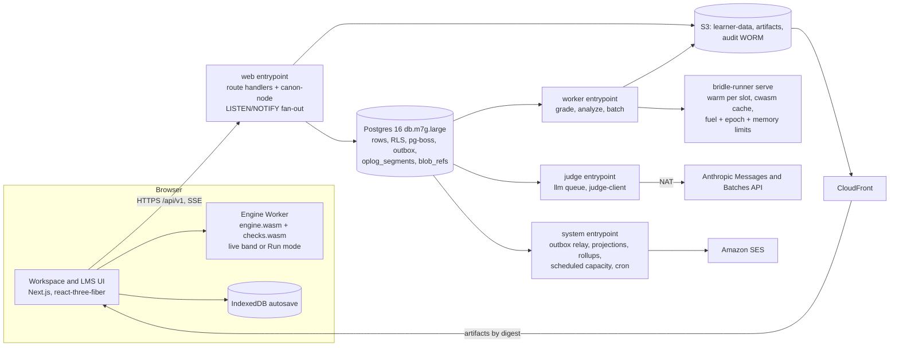

<!-- Source: architecture workflow wf_79250bb6-1e6 (3 proposals, 3 judges, synthesis, 2 adversarial refuters, refine), 2026-11-03. Binding inputs: ADR 0001, docs/requirements. -->

# Bridle MVP architecture (PLAN-02 final)

Status: final for plan approval. Inputs: ADR 0001 (R1-R18 and guardrails), requirement sets 00-14, the three PLAN-01 proposals and judgments, the PLAN-02 synthesis and its two adversarial reviews (performance and determinism; small-team delivery and cost). Every major review issue is resolved in the design below and itemized in the change log; four items need an ADR amendment and are listed in section 2 for the user to confirm at plan approval.

## 1 Overview and goals

Bridle is a simulation-native LMS for structural engineering. The product is one loop: open a task with a site scenario, build or adjust a structure in a live 3D workspace, self-check, write a memo, submit, receive per-criterion clause-cited feedback that an instructor reviews, resubmit. The architecture serves that loop and nothing else at MVP.

Goals in priority order:

1. Trustworthy grades: one Rust core, identical wasm bytes in the browser and on the server, every grade reproducible from its pin set, the LLM confined to judged criteria and fenced by a deterministic grounding validator. New in this revision: the browser's incremental engine is provably equivalent to a fresh server solve (the fresh-equivalence invariant, section 7), so "exact" result_match is the normal outcome rather than a hope.
2. Live modeling: models inside the live band (predicted solve work <= 2e8 flops and <= 6,000 DOF) re-solve and repaint within 100 ms p95 on the S reference scene and 300 ms p95 on the M reference scene (10-storey 6x6-bay frame, 1,300 members, 3.2k DOF, 20 combinations) on the reference laptop; larger Tier-M models run in Run mode with progress (3 s target, 5 s budget). The numbers are measured in the week-1 spike on M1/Safari and Tiger Lake/Chrome and weekly thereafter on self-hosted hardware; until measured they are planning values.
3. Operable by four engineers plus a budgeted 0.75 FTE run and support allocation per pilot term: one Docker image with four entrypoints, Postgres and S3 as the only stateful services, no Redis, no autoscaler (calendar-scheduled capacity instead), six rehearsed runbooks.
4. Institution-ready: row-level security tenancy, FERPA disclosure log, WORM audit, MFA for privileged roles, third-party pentest booked for the code-freeze window before the first institutional pilot.
5. Extensible without migration: pack traits, reserved schema fields for shells, teams and the EU region, content-addressed artifacts, a provider-agnostic judge-client seam.

Target: first production pilot in spring 2028, production-ready and content-ready on 2027-12-01, with a formative-only friendly alpha in one design-partner section in summer 2027. Non-goals at MVP: shells, iterative P-delta, a second code pack, HSS/pipe/E4/F3/F6/F7/ASD resistance checks (pack minors after the pilot), Diagnose injector and content, LTI and SAML, team co-editing, EU region, WebGPU, auto-release of summative grades.

## 2 Constraints and binding decisions

ADR 0001 is binding: steel-only US pack (R1, R2); no shells, one-way panels (R3); linear static plus B1/B2, notional loads, the 12.8.7 theta check, slenderness advisories and mechanism detection (R4, amended by ADR 0002 A5 to Chapter C with DAM default and ELM opt-in); one Scenario schema at simplified fidelity (R5); one rubric schema (R6); server re-analysis is the only grading input and resultHash equality is the integrity check when artifacts match (R7); one schema package with canonicalize(), Z-up, XZ plane (R8); the checks library is its own pinned artifact (R9); author references plus an auto-sized reference per seed (R10, amended by ADR 0002 A7 to a bounded fixed point); 100 percent instructor review of summative grades, formative deterministic results released immediately with an AI-provisional narrative (R11); email/password, Google and Microsoft OIDC, TOTP or passkey MFA for instructor, author and admin roles (R12); single US region with tenant.region reserved (R13); S and M tiers with a per-task hard cap enforced identically on both sides, WebGL2 only (R14); outcome tags and a simple mastery rule (R15); accessible parity path (R16); composite grader_version frozen per published task version (R17); namespaced ids (R18). Guardrails: small fixed worker pool with per-tenant caps, staging and production only, rolling deploys with manual rollback, 99.5 percent availability, ASVS 5.0 L1 plus the L2 authentication, access-control and data-protection controls, per-tenant LLM counters plus one global cap.

Proposed ADR amendments (confirm at plan approval):

- A1 (R14): the latency contract attaches to the live band (predicted flops <= 2e8 and DOF <= 6,000, computed by the same symbolic analysis on both sides) and to two committed reference scenes (S-ref: roof truss under snow and wind, about 150 members and 450 DOF; M-ref: 10-storey 6x6-bay 3D frame, 1,300 members, 3.2k DOF, 20 combinations). Tier S and Tier M remain the size tiers (<= 200 and <= 2,000 members); Tier-M models above the live band run in Run mode with progress (<= 3 s target). The R14 figures of 100 ms and 300 ms p95 are solve plus render; utilization overlays follow one debounce later (<= 200 ms).
- A2 (R1): MVP resistance checks are AISC 360-22 LRFD for W-shapes: D2 yielding and rupture with U, E3 flexural buckling (nonslender elements per Table B4.1a), F2 and F3 doubly symmetric flexure (compact and noncompact flanges) with Lp/Lr/Cb, F6 compact weak-axis flexure, G2 shear with Cv1, H1-1a/b with Mcy from F6, Table B4.1 classification per limit state and per Fy (the section allow-list is filtered per (shape, Fy, member use) from the shapes database at authoring time: F2/F3 compactness for flexure, B4.1a nonslender for compression; refused shapes are listed to the author and reported as unsupported, never silently graded), Lc/r <= 200 and L/r <= 300 advisories. HSS and pipe (F7), E4, E7 and ASD ship as pack MINOR versions after the pilot. The starter course is beams, trusses and W-section frames.
- A3 (MVP-01, CAT-03): the seeded-error catalog and InjectedErrorSet schemas ship in the schema package; the Diagnose injector, grading path and content are v1.1.
- A4 (calendar): the first production pilot is spring 2028 (production-ready 2027-12-01, course content-ready the same day, six weeks before term); summer 2027 runs a formative-only friendly alpha with one design-partner section and no credit-bearing grades.
- A5 to A10 (stability method, RC Analyze-only, fixed-point auto-sizing, CSV layouts, deferrals, cut-list corrections) are recorded with A1 to A4 in `docs/decisions/0002-architecture-amendments.md`.

User defaults kept: TypeScript monorepo, Next.js with react-three-fiber, Node, Postgres, one Rust core compiled to wasm and native, S3, Anthropic SDK with claude-opus-5-5 for judgment and claude-haiku-5-5 for screening.

Three deviations, each justified: (a) the job queue is pg-boss on Postgres rather than Redis, so a submission row, its learning event and its grading job commit in one transaction and the zero-lost-submissions exit criterion is a database invariant; a Jobs interface keeps the Redis path open. (b) The Node API is Next.js route handlers over a framework-agnostic handler package rather than a second Fastify service, halving auth, tracing and deploy plumbing; a Hono mount of the same package is the escape hatch if route-handler streaming misbehaves. (c) Postgres runs on a db.m7g.large Multi-AZ instance rather than a burstable class, because the database is also the queue, the outbox and the SSE change source and must be sized for deadline week, not idle.

First-round resolutions (judge finding -> decision) stand: engine on the worker event loop -> authoritative solves run in bridle-runner under Wasmtime with fuel, memory and wall limits; public-IP Fargate tasks -> private subnets, VPC endpoints, one NAT, internet egress only for the judge and the telemetry collector; Auth.js credentials provider cannot create database sessions -> an explicit server-side session table with revoke-all within 60 s; RLS-bypassing ops role in the web process -> the console runs under the application role with per-request tenant context and a platform directory table; silence on C6 -> GRD-03 banding is written into the strength scoring function and a harness fixture scores a DC 1.05 primary member at the 50 percent cap; hazard dataset as loose content -> hazard:us-sites is an ArtifactRef in every pin set and unverified check ids cannot score without a visible instructor override (VER-02); native-must-match-wasm release gate -> native is compared by tolerance (1e-9), only wasm hosts must be bit-identical; four LLM calls -> judge and narrative in one structured call, at most three calls; autoscaling and three services -> one image, four entrypoints, fixed pool with calendar-scheduled capacity; pentest deferred -> booked inside the hardening step; WebSocket stream with presence -> SSE from route handlers; unexercised seams -> only seams with a CI test and a known v1.x consumer are kept.

Second-round resolutions, in one paragraph (details in the sections named): live band and reference scenes replace the undeived Tier-M number (sections 7, 8); the fresh-equivalence invariant and a result_summary document make result_match computable and exact by default (sections 6, 7, 10); results are hashed as an int64 frame and stored as a zstd generating set (section 6); bridle-runner is a warm per-slot process with a cwasm cache (section 4.5); the cross-host hash gate runs on the sparse path corpus and performance gates use wasmtime fuel (section 7); judge latency and cost are measured before any SLO or budget is fixed, formative judging goes through Batches, and the cost basis is the cold-cache case (sections 4.14, 10, 12, 14); op-log segments live in Postgres with S3 rollups and a blob reference table (sections 4.12, 5); the plan is re-estimated at 165 engineer-weeks with the cut list applied by default, a dated critical path, a launch budget, a run allocation and a model-retirement runbook (sections 4.15, 14, 17).

## 3 System diagram and component table



| Component | Runtime | Technology | Interfaces |
|---|---|---|---|
| Web app (UI and /api/v1) | ECS web service, 2 x 1 vCPU/2 GB (4 inside deadline windows) | Next.js 15, React 19, zod to OpenAPI 3.1, Drizzle | REST, SSE with LISTEN/NOTIFY fan-out, presigned S3, pg-boss enqueue, emit() |
| Engine Worker | browser | Web Worker, wasm-bindgen glue, resumable solve phases | Worker Protocol v1 (seq, cancel, transferables, estimate, freshSolve) |
| Workspace UI | browser | react-three-fiber v9, three.js WebGL2, three-mesh-bvh, zustand | command bus, document store, deliverables dock, chunked overlay rebuild |
| bridle-core | browser and server | Rust workspace to engine.wasm and checks.wasm; native for CI, bench and CLI | Rust API, Worker Protocol, runner job protocol |
| bridle-runner | worker subprocess, one warm process per slot | Rust plus wasmtime; cwasm cache; fuel, epoch and memory limits | job-directory contract over a line protocol; one-shot mode for CLI and support |
| worker | ECS worker service, 2 x 2 vCPU/8 GB (4 inside windows) | Node 22, pg-boss processors grade, analyze, batch | Postgres, S3, runner |
| judge | ECS judge service, 1 x 0.5 vCPU/1 GB | Node 22, pg-boss llm processor, packages/grader/judge-client over @anthropic-ai/sdk | Anthropic Messages and Batches API, Postgres |
| system | ECS system service, 1 x 0.5 vCPU/1 GB | Node 22, outbox relay, projections, segment rollups, scheduled capacity, cron, SES | Postgres, S3, SES, ECS UpdateService |
| grader package | worker and judge | TypeScript pure stage functions, zod | GradeEvidence, EvidenceDigest, JudgeOutput schemas, judge-client contract |
| schema package and canon-node | everywhere | schemars to JSON Schema to TS and zod; engine.wasm in Node loaded by pinned engine_ref | canonicalize, hash, result frame, result_summary, parseId, parseArtifactRef, emit() |
| Postgres | AWS RDS | PostgreSQL 16 db.m7g.large Multi-AZ, RLS, pg-boss, partitioned events and segments | Drizzle over TLS, LISTEN/NOTIFY |
| Object storage | S3 plus CloudFront | SSE-KMS, versioning, Object Lock bucket | content-addressed keys, presigned URLs, segment rollups |
| Artifact registry and packs | web and CI | artifacts table, S3 by digest, bridle-cli publish and promote | GET /artifacts/{ref}, two-person promotion, break-glass rollback |
| Operator console | web app /ops route group | platform_admin plus MFA | /api/v1/ops/* |
| Observability | sidecar plus SaaS | OTel collector gateway, Grafana Cloud (metrics, logs, traces, alerting, OnCall, synthetics), Sentry, hosted status page | OTLP, pino JSON |

## 4 Components

### 4.1 Web app

One Next.js 15 application serves every role surface and the typed REST API under /api/v1 as route handlers. Handlers are thin: zod parsing, authentication, authorization, then a call into packages/api-core, a framework-agnostic module of pure handler functions over a typed context (transaction with tenant set, actor, clock, jobs, storage). OpenAPI 3.1 is generated from the same zod schemas and packages/api-client from it. Every transaction opens with SET LOCAL app.tenant_id and app.actor_id; jobs are enqueued inside the same transaction as the state change; events go through emit() into the outbox; presigned S3 URLs expire within 15 min; rate limits are 600 req/min per user, 120 per anonymous IP, auth 10/min/IP, uploads 20/h at <= 25 MB; every response carries the disclaimer envelope.

SSE: GET /submissions/{id}/status and the review-queue stream are served from route handlers. Each web task holds one dedicated Postgres connection that LISTENs on bridle_jobs and bridle_review; a trigger on grading_jobs state changes and the outbox relay NOTIFY with {tenant_id, submission_id, state} only; an in-process emitter fans out to open streams whose subscriber authorization was checked at subscribe time; detail fetches go through the API under RLS. Comment keepalives every 25 s, ALB idle timeout raised to 3,600 s, event ids with Last-Event-ID replay from the grading_jobs row on reconnect, a cap of 5 streams per user, and a fallback to 5-second polling of one projection when the cap is hit. No stream polls Postgres.

Op-log segments: the workspace posts a segment every 30-60 s while editing and immediately on blur, tab hide and submit (not every 5 s); the handler stores the zstd segment as one row in oplog_segments with its hash chain. Crash loss stays <= 2 s through IndexedDB; the AVL-03 server-save bound of 10 s is met by coalesced model revisions, not per-op rows. Two Fargate tasks at 1 vCPU/2 GB; the scheduled capacity policy raises the desired count to 4 inside deadline windows.

### 4.2 Engine Worker

A TypeScript Web Worker hosts engine.wasm and, when the assistance profile allows, checks.wasm, both fetched by digest from CloudFront with immutable cache headers and SRI. Worker Protocol v1: loadModel, applyOps(ops, seq), estimate, solve(seq) with progress and cancel, freshSolve (load the canonical model from scratch and solve, used at submit), check(packDigests), selfCheck(profile), canonicalize, resultSummary. estimate() returns {dof, nnzK, nnzL, flops, cases, liveBand: boolean, tier} from the symbolic analysis; liveBand is true when flops <= 2e8 and dof <= 6,000 and cases <= 24 and combinations <= 60, and the same function decides on the server.

Live band: debounce 30 ms (100 ms during drags), superseded sequence numbers dropped before the next phase boundary, wasm memory capped at 1 GB, restart on panic preserving last good results. Above the live band the worker switches to Run mode: explicit run or auto-run with progress events every 250 ms, 3 s target, 5 s budget, cancellable. Cancellation without SharedArrayBuffer: the solve is structured as resumable phases held in wasm memory (assemble, symbolic, numeric factorization in column blocks of about 20 ms, right-hand-side batches, recovery, checks) and the worker returns to its event loop between phases, so a cancel or a newer sequence number is observed within about 50 ms; worker.terminate() is reserved for panics.

Results stay inside the worker: per-case nodal and station results are retained in wasm memory; the main thread receives only the active case or combination overlay (about 1 MB at Tier M) plus the per-member envelope summary as transferables, and combinations are superposed on demand in the worker (< 5 ms) when the user switches. Live checks run one debounce behind the solve so the R14 contract covers solve plus render and utilization follows within about 200 ms. A Long Tasks assertion keeps engine message handling under 16 ms and any scene work under 50 ms (SBX-01).

### 4.3 Workspace UI

react-three-fiber v9 on the three.js WebGLRenderer; instanced glyphs, merged line geometry, BVH picking, on-demand frame loop, <= 200 draw calls, labels declutter above 500. Instancing and BVH picking are built from day one so performance work is never a rewrite. One command bus serves toolbar, shortcuts, palette, tabular editor and tests; the document is immutable with an invertible op log (>= 200 undo steps); IndexedDB autosave within 2 s; segments as in 4.1. Overlay buffer rebuilds are chunked across frames (deformed shape first, diagrams and utilization next frame) so no single scene task exceeds 50 ms on the M reference scene.

The workspace is delivered in three slices: (a) parity-first core (document store, command bus, tabular editor, property panel, worker integration, 2D mode, autosave and segments; also the e2e and tutorial surface and the author mode used by step 8), (b) 3D authoring tools (grid, working plane, snapping, node and member drawing, supports, loads, sections, selection, gizmos, copy, mirror, replicate by level, undo), (c) overlays and pedagogical panels: deformed shape (Hermite), N/V/M ribbons, utilization colour map with DC > 1.00 hatched, reactions and equilibrium panel with residual highlight, null-space mechanism animation, a "show my loads" panel listing every derived load with its scenario parameter, intermediate code parameter and clause, a diagnostics panel, and the grader feedback overlay keyed by stable element ids. Deferred to v1.1: extruded true-section rendering, named views, radial arrays, more than one pinned probe, the snapshot title block. The deliverables dock hosts Report values, Findings, Memo (KaTeX, 2 s autosave, paste provenance), Snapshots and the submission checklist; the task page mirrors it for the non-canvas path (R16).

### 4.4 bridle-core and the two artifacts

Crates: bridle-canon (schemars-annotated schema structs, canon/1, hashing, result frame, result_summary, ids, ArtifactRef, event validation), bridle-fem (direct-stiffness solver, VAL-* rules, ENG-* diagnostics), bridle-packs (LoadsPack and ResistancePack traits, bundle loader, pack_us_asce7_22, pack_us_aisc360_22), bridle-checks (limit-state catalog, GradeEvidence emission, ERR-01..07 detectors, efficiency and economy, Analyze and Check comparators), bridle-scenario (PCG32 seed engine, instances, hidden reference sets), bridle-fingerprint (WL plus MinHash; computed and stored at MVP, reported in v1.1), bridle-wasm-engine and bridle-wasm-checks (facades), bridle-cli (native: bench, golden, pack-validate, replay driver). Two artifacts per release: engine:bridle-fem@semver#sha256 (fem plus canon) and checks:bridle-checks@semver#sha256 (checks, packs, scenario, fingerprint, canon). Both target wasm32-unknown-unknown with +simd128, no threads, no relaxed SIMD, libm, no FMA, single-threaded; each <= 1.5 MB raw and 500 KB gzipped, instantiated in under 300 ms.

### 4.5 bridle-runner

A Rust binary embedding wasmtime with two modes. bridle-runner serve --slot <n> is the production mode: one long-lived process per worker slot that loads the pinned engine and checks modules once from a cwasm cache keyed by (artifact digest, wasmtime version, target triple and CPU features; populated at artifact promotion by wasmtime compile and verified by digest), and serves jobs over a stdin/stdout line protocol with a fresh Store, fresh linear memory and a fresh epoch deadline per job, so cross-tenant isolation per job is preserved while per-job overhead falls to module instantiation (about 1-5 ms) instead of Cranelift compilation (0.5-2 s). bridle-runner run <op> --job-dir <dir> is the one-shot mode for the CLI, CI and support replay. The job directory (task ephemeral storage, 64 MB cap, no tmpfs) holds model.json, scenario.json, task-rules.json, pack bundles and digests; outputs are result.frame (header plus int64 arrays), result.generating.zst, summary.json, evidence.json and hashes.json; typed errors go to stderr with a non-zero exit. Ops: analyze, recover, check, self_check, scenario_instantiate, reference_sets, canonicalize, replay. Limits: fuel calibrated to 10x the M-cap benchmark (fuel is the deterministic work meter), epoch interruption at 60 s wall, 512 MB linear memory; the module imports only memory and a log sink. The EngineRunner interface has two implementations: wasmtime (production) and wasm-node (worker_threads with resourceLimits and terminate(); local dev, CI and operational fallback). CI asserts identical result_hash between them.

### 4.6 worker

Same image, node dist/worker.js: pg-boss processors for grade (S0-S2, S4, S5 routing), analyze (calibration, test-submit, hidden-set generation at activity release) and batch (regrades, bulk re-pin, harness, backfill). Each task runs two runner slots as warm serve processes; concurrency equals slots. Memory arithmetic per task: Node 0.5 GB plus two runner processes at up to 0.6 GB each (512 MB linear memory plus host) plus headroom, so tasks are 2 vCPU/8 GB. Two Fargate tasks; the scheduled capacity policy raises the desired count to 4 inside deadline windows and the audited operator control can do the same at any time.

### 4.7 judge

Same image, node dist/judge.js, the only service whose security group allows egress to api.anthropic.com. Processes the llm queue: summative judged stages interactively at global concurrency 8 (12 inside deadline windows), formative judged stages through Message Batches in hourly batches (formative tasks promise deterministic results immediately and only an AI-provisional narrative, so the batch delay is acceptable and halves the cost), and calibration, regrades and the harness through Batches. Every provider call goes through packages/grader/judge-client, a thin contract (judge(request) -> JudgeOutput, screen, countTokens, batchSubmit, batchPoll) with the record/replay fixtures as its test contract, so a second provider is a contained change. It assembles cache-stable prompts, runs the grounding validator, writes judge_invocation rows and the judge cache. One task at 0.5 vCPU/1 GB.

### 4.8 system

Same image, node dist/system.js: outbox relay into projections (gradebook, progress, mastery, notifications, analytics) and NOTIFY for SSE; segment rollups every 15 min and at session end (open-session segment rows coalesced into one content-addressed S3 object per session window, rows deleted after the rollup commits, blob_refs updated); SES email; reconciliation every 15 min; retention daily; deadline-window recompute nightly and on due-date change; scheduled capacity (ECS UpdateService on worker and web desired counts and the judge concurrency flag at window start and end, audited as actor policy); hourly WORM audit copy; LLM backfill after a kill switch; transient dead-letter auto-replay (infrastructure and timeout classes, up to 3 attempts with backoff, audited as actor policy); artifact warm-up and cwasm cache population. Isolated so a deadline burst never starves projections or the reconciliation invariant. One task at 0.5 vCPU/1 GB.

### 4.9 grader package

Pure, testable stage functions shared by worker, judge and the harness: bundle validation and PII scrub, evidence digest selection (<= 12k tokens verified by count_tokens), prompt assembly with cache breakpoints, the JudgeOutput schema (criteria plus narrative, no field that can touch an auto score), grounding validator, scoring functions, gates, confidence, routing, archetype graders wrapping the Rust comparators, the judge-client contract, and the bridle-grader eval harness.

### 4.10 schema package and canon-node

packages/schema is the single source of truth: JSON Schemas generated from the Rust structs by schemars and committed (CI fails on drift), TypeScript types and zod validators generated from them, the entity/prefix/event registry with a CI lint, quanta tables with per-field overrides, a golden corpus of at least 50 vectors, parseId, parseArtifactRef and emit(). packages/canon-node loads engine.wasm by the task's pinned engine_ref and canon_version (not one global digest) inside the web process to recompute model_hash at submit (422 on mismatch), hash deliverables and the result_summary, and run estimate() for cap and live-band checks; a lint forbids any other hashing code path.

### 4.11 Artifact registry and packs

An artifacts table plus S3 content by digest; kinds engine, checks, codepack, clauses, sections, materials, cost, hazard, prompt, judge, grader, scengen, schema, canon; lifecycle candidate, verified, default, deprecated, revoked; per-kind gates (engine: cross-host hash equality on the full determinism corpus of section 7 and a fuel regression under 5 percent; checks and codepack: conformance suite plus signed SME record; clauses: SME record plus no-verbatim scan; grader: harness thresholds and cost within the measured budget); two-person promotion and revocation, with single-admin break-glass rollback to the previous pin set inside deadline windows and a mandatory next-business-day second review; never deleted, runnable at least 3 years; rollout rings staging, sandbox tenant, opted-in pilots, default. Promotion also compiles and caches the cwasm for the runner.

### 4.12 Postgres

RDS PostgreSQL 16 db.m7g.large Multi-AZ (2 vCPU, 8 GB), PITR 35 days, daily snapshots copied to a second region and a second AWS account. Holds every entity, the pg-boss queue, the append-only events table (outbox, audit index, learning record, process class) in monthly partitions, oplog_segments in daily partitions (bytea zstd segments for open sessions only), blob_refs, projections, flags, deadline_windows and artifacts. There are no per-op rows: ops exist only inside segments. Write-rate model at the SCL-01 target of 500 concurrent workspaces: about 5.5 segment inserts per second (250 active sessions, one 45-second segment each, about 4 KB zstd), submissions and job transitions in the tens per second, events a few hundred per second at a deadline; reads a few hundred per second. The k6 burst test runs on the production instance class before the pilot. Roles: bridle_app (RLS enforced, no BYPASSRLS) and bridle_migrate. Immutable tables have UPDATE and DELETE revoked plus triggers. UUIDv7 is generated application-side.

### 4.13 Object storage

bridle-artifacts (wasm, cwasm, pack bundles, prompts, judge schemas; CloudFront, immutable headers), bridle-learner-data (tenant-prefixed, SSE-KMS, 30-day versioning: model revisions, result generating sets, result frames only when a grade references them, evidence, submission bundles including result_summary, segment rollups, attachments, snapshots, diagnostic bundles, LLM logs under a separate KMS key) and bridle-audit (Object Lock compliance mode, 7 years). Keys: tenant/<ten_id>/<kind>/<sha256>; artifacts/<kind>/<name>/<version>/<digest>. Content-addressed objects can be shared by two learners (an untouched starter model, an identical revision); blob_refs (object key, referencing entity, tenant) makes erasure and retention safe: an object is deleted only when its last reference is gone, and a learner's erasure removes their references and pseudonymizes their rows. PUT rate at the MVP target is about 0.3 per second (rollups), which is about $4 per month.

### 4.14 Claude API

Called only from judge through judge-client. Routes: screen on claude-haiku-5-5; judge-plus-narrative on claude-opus-5-5 with thinking {type: adaptive} and output_config.effort pinned explicitly per route (the model's default is medium; the measurement spike runs medium and high and the harness pins the cheapest effort that holds the gates), output_config.format = JudgeOutput (additionalProperties false, enum levels and verdicts), max_tokens 16,000 with streaming and finalMessage() (thinking counts toward max_tokens), no server-side fallbacks, response.model asserted; messages.batches for formative judged stages, regrades, calibration and the harness; count_tokens for budgets. The one regeneration after a validator failure is a mid-conversation role:system message appended to the same conversation with the assistant turn and its thinking blocks passed back unchanged. A claude-sonnet-5-5 formative route exists in configuration but is disabled at MVP; enabling it bumps grader_version. Fast mode (research preview, 2x price, its own rate pool) is evaluated in the spike as an optional deadline lever and adopted only if measured; it is not a dependency. Model retirement: the provider retires models on a roughly 12-18 month cadence, so judged criteria are declared non-replayable after the pinned model is retired; the retirement runbook in 4.15 governs the response.

### 4.15 Operator console

Route group /ops in the web app behind platform_admin plus an MFA challenge within 12 h and an optional IP allowlist; every write needs a reason; every education-record read emits a disclosure event. Tenant provisioning, job inspector (retry, re-run from stage, cancel, bulk <= 1,000), dead letters, reconciliation and lost-work counter, artifact registry, pin override, rollback and bulk re-pin, grade quarantine, LLM budgets and kill switches, flags, view-as and consent-token impersonation, DSR workflow (audited scripts plus runbook at MVP, UI in v1.1), deadline windows, incident banners, support triage queue fed by the support mailbox (SES inbound, no help-desk vendor at MVP), and burst controls (scale pool, pause batch lane, raise tenant cap, defer judged stages to Batches). Six rehearsed runbooks: grading backlog at a deadline (first action: defer formative judged stages to Batches, then scale), LLM provider outage, engine or pack regression, lost autosave or submission, tenant data-access error, and model deprecation notice (create pins-only task versions with the successor model id for new attempts, re-run the harness and calibration, declare judged criteria on the retired model non-replayable, route appeals on retired models to instructor manual judging with deterministic criteria recomputed and judged scores carried, record the provider's deprecation policy in the procurement pack).

### 4.16 Observability

OpenTelemetry from browser fetch and SSE through route handlers, pg-boss payload traceparent, runner timings and the Anthropic SDK, shipped through an in-VPC OTel Collector gateway to Grafana Cloud (metrics, logs, traces, alerting, OnCall paging, synthetic probes every 60 s from two regions); Sentry for web, Node and the wasm panic hook; a hosted status page that receives no learner data. Subprocessors at MVP: AWS, Anthropic, Grafana Labs, Sentry, the status-page vendor; each is listed in the procurement pack with the data classes it receives. Performance evidence: a weekly job on one self-hosted M1 Mac mini (Safari and Chrome) and one Tiger Lake laptop (Chrome) runs the reference scenes and publishes solve, checks, scene and frame timings as the R14 evidence.

## 5 Data model

Tenancy: one database, one schema. Every tenant-scoped table carries tenant_id NOT NULL with an RLS policy USING (tenant_id = current_setting('app.tenant_id')::uuid); users, artifacts and flags are global; CI fails if a tenant table lacks a policy; the two-tenant every-role authorization suite is a release blocker. tenant.region is stored and fixed to 'us'.

Entities (prefix; key fields):

- tenants (ten_): slug, region, timezone, default_unit_system, default_pack_refs, type (pilot_institution | institution | sandbox), plan, entitlements JSONB, llm_budget_monthly_cents, state, analytics_key_id.
- users (usr_), sessions, mfa_methods: email citext, argon2id password_hash, status; sessions store a hashed 256-bit token, expires_at (idle 12 h learners, 2 h privileged), absolute_expires_at (30 d), mfa_verified_at, revoked_at.
- role_assignments (mem_): role (learner | ta | instructor | author | institution_admin | platform_admin), scope_type (platform | tenant | offering | section), scope_id.
- course_blueprints (cbp_), course_versions (cbv_): outline JSONB with stable activity_key, content_hash, state.
- offerings (off_), sections (sec_), enrollments: term, timezone, late_policy, enrollment state machine, extensions and accommodations JSONB.
- activities (act_): type, task_version_id, available_from, due_at, close_at, points, completion_rule, formative, current_pinset_id, affected_learner_count (maintained for deadline windows).
- deadline_windows: tenant_id, starts_at, ends_at, source activity ids; derived nightly and on due-date change from summative activities with >= 25 affected learners (NFP-05), windows [due - 48 h, due + 24 h] including extensions, merged per tenant.
- task_definitions (task_), task_versions (taskv_): definition JSONB (scenario schema, code basis, deliverables, constraints, assistance profile, exam profile, parameter specs, locks, hints, collaboration and AI-use policy, per-task hard cap), task_hash, pins_only_of_version.
- rubrics (rub_), rubric_versions (rubv_): criteria JSONB (kind auto | judged | hybrid | manual, dimension from the GRD-02 list plus analysis_accuracy, code_check_reporting, diagnosis, weight, scoring_fn, gate), rubric_hash.
- activity_pinsets (pin_): refs {engine, checks, codepacks[], clauses, sections, materials, cost, hazard, rubric_version, task_version, content_version, grader, prompt, judge_schema, llm_model_id, effort}, pinset_hash, effective_from, regrade_policy, supersedes_pinset_id.
- scenario_instances (sci_): seed, generator_ref, quantized params, scenario_hash, hidden_sets keys (ReferenceAnswerSet, CheckKey, InjectedErrorSet schema present, auto-sized reference); hidden sets are generated at activity release for enrolled learners and at enrollment, cached by (task_version_id, seed), with on-demand generation only as the fallback.
- model_documents (mdl_): owner_type, owner_id, team_id (null at MVP), course_id, section_id, task_id, forked_from, head_seq, lock JSONB (reserved).
- model_revisions (mrev_): seq, model_hash, canon_version, schema_version, s3_key, reason.
- oplog_segments: (document_id, segment_seq) primary key, session_id, actor_id, first_seq, last_seq, op_count, sha256, prev_hash, bytes (bytea, zstd), created_at; daily partitions; rows for open sessions only; every op inside carries client_op_id, actor_id, actor_role, session_id, origin, base_seq, lock_epoch, gesture_id, kind, target, before, after.
- segment_rollups: document_id, window_start, window_end, first_seq, last_seq, head_hash, s3_key; promoted to learning retention when referenced by a submission.
- blob_refs: s3_key, tenant_id, referencing_entity_type, referencing_entity_id; unique per reference; reference counting for erasure and retention.
- submissions (sub_): the full DM-05 pin set (content pins, work pins, client context including client_result_hash and result_summary_hash, provenance, fingerprint, pledge, exam attestation, assistance profile), deliverables JSONB with per-deliverable hashes, lateness, submission_hash, status.
- grading_jobs (job_): submission_id, pinset_id, grader_ref (unique together), state, stage cursor, stage_outputs, pgboss_job_id, error; a trigger NOTIFYs on state change.
- result_sets (res_): unique (model_hash, scenario_hash, engine_ref, numeric_profile, analysis_options_hash), result_hash (over the full frame), generating_set_s3_key, frame_s3_key (nullable; written only when a grade references the result set), timings, fuel_used, warnings.
- evidence_records (evd_): evidence_hash, digest_hash, s3_key, plus indexed rows per record for analytics and feedback views.
- grade_versions (grd_): DM-06 pins, result_match {kind: exact | within_tolerance | mismatch | not_compared, comparison: full_hash | summary, max_rel_diff}, judge_invocations[], criterion_scores[] with source (deterministic | judge | instructor | carried), total, confidence, flags, quarantine, status, grade_hash; append-only.
- judge_invocations: prompt_ref, judge_schema_ref, llm_model_id, api_version, effort, request_hash, response_id, response_model, output_hash, usage {input, cache_creation by TTL, cache_read, output}, latency_ms, inference_geo, validator_outcome, batch_id (nullable), encrypted log key; also the judge cache.
- integrity_signals, exam_attestations, pledge_records: append-only; never change a score.
- artifacts, verification_records, cwasm_cache_entries; the licensing register lives as YAML in the repo and is mirrored.
- events (evt_): CloudEvents envelope columns, class, prevhash for audit, monthly partitions; event_cursors per consumer.
- projections gradebook_items, progress_records, mastery_records, notifications: rebuildable from learning events (tested).
- feature_flags, dead_letters, diagnostic_bundles, consent_records, tenant_keys, support_tickets, quizzes, quiz_attempts, discussion threads.

Storage: Postgres rows and JSONB up to about 64 KB; S3 for every blob, content-addressed. Retention: learning records 5 years after the offering ends, then pseudonymized; LLM logs 12 months; process class 30 days; segment rollups 90 days unless referenced by a submission; result generating sets 30 days or while referenced by a grade; audit 7 years WORM; backups 35 days daily and 1 year weekly; erased users purged within 30 days primary and 90 days backups.

## 6 Structural model schema package

Source of truth: Rust structs in bridle-canon annotated with schemars generate bridle-model.schema.json (JSON Schema 2020-12) and every other shared schema (ops, scenario, result frame, result_summary, evidence, deliverables, task, rubric, pin sets, events, integrity, exam profile, attestation, seeded-error catalog, comment); TypeScript types and zod validators are generated from the committed JSON; CI fails on drift and on any JSON.stringify or serde_json hashing outside bridle-canon. Versions: bridle-schema@1.0.0 (minor versions additive and readable by N-1 consumers for 90 days), canon:1 (any change to semantic fields, quanta, ordering or header bumps canon and never rewrites stored hashes), bridle-events@1.0.0. The task, rubric and deliverable schemas are frozen at the month-3 contracts milestone with example fixtures so design partners author against a stable contract.

Conventions frozen before any code (R8, DM-09): right-handed global frame, +Z up, gravity [0, 0, -9.80665]; 2D models in the XZ plane with Y = 0 and out-of-plane DOFs implicitly restrained (settings.mode 3d | 2d-xz); SI base units only, display units in a separate view-state document; member local 1 from node i to node j, local 2 in the vertical plane toward +Z (vertical members use +X), roll angle in radians; major-axis bending is M3; sign conventions documented once by bridle-fem.

Document shape: header; settings; materials; sections (catalog, parametric or custom with A, Iy, Iz, J, Cw, Sy, Sz, Zy, Zz, ry, rz, Asy, Asz, dims); nodes; levels; members (frame | truss, releases, offsets, timoshenko, design {Ky, Kz, Lb, Cb, bracedLateral, role}); links; supports (six DOF fixed | free | {k}, localAxes); loadCases with generator provenance; loads (nodal, memberDistributed, memberPoint, thermal, areaPanel, settlement); panels (one-way); combinations; analyses (linearStatic); groups. Reserved and schema-present but validation-rejected at MVP: shells, regions, constraints, tension-only behaviour, modal, buckling, pDelta, two-way panels. Every element has a client-generated, never-reused typed id; cross-references are by id; ordered collections carry fractional order keys; tombstones live in the op log.

Canonicalization canon/1, implemented once: project onto schema-flagged semantic fields (drop labels, colours, camera, selection, comments, timestamps, authorship, display units); materialize defaults; quantize each number to an integer count of its dimension quantum (length 1e-6 m, angle 1e-6 rad, force 1e-3 N, moment 1e-3 N m, line load 1e-3 N/m, stress and modulus 1 Pa, area 1e-10 m2, I and J 1e-14 m4, warping constant Cw 1e-18 m6, section modulus 1e-12 m3, density 1e-3 kg/m3, temperature 1e-3 K, temperature gradient 1e-6 K/m, thermal expansion coefficient 1e-12 per K, strain and damping 1e-9, springs 1e-3 N/m and 1e-3 N m/rad, mass 1e-6 kg, dimensionless 1e-6, currency 1e-4) with round-half-to-even, -0 to 0, non-finite is an error; every numeric field in the schema carries an explicit quantum annotation and a CI test walks the schema and fails on any numeric field without one; a quantized count with |n| >= 2^53 is a canonicalization error, never a silent overflow; NFC strings, snake_case enums, omit absent optionals; arrays sorted by id; header {"schema":"bridle-schema@1.0.0","canon":1,"kind":"model"}; RFC 8785 JCS, UTF-8, SHA-256, string form sha256:<hex>. Canonical bytes contain only integers, strings, booleans, arrays and objects.

Analysis-input invariant: on both sides the solver consumes dequantize(canonicalize(model)), never the raw revision, so model_hash identifies exactly the model that was analyzed and the result cache key is never coarser than the solver input. A golden test asserts solve(raw) hash equals solve(canon(raw)) hash for every template and 1,000 random edits.

Result frame (kind result, hashed, not JCS): header = JCS of {"schema","canon":1,"kind":"result","pins":{model_hash, scenario_hash, engine_ref, numeric_profile, analysis_options_hash},"layout":{cases sorted by id, node count, member count, stations (11 default), component order}}; body = for each case in header order, int64 little-endian arrays of quantized values in canonical order (nodal displacements by node id then component, reactions by support id, member station results by member id, station, component) followed by the per-member envelopes (max and min per component with governing combination index). Quanta: displacement 1e-9 m, rotation 1e-9 rad, force 1e-3 N, moment 1e-3 N m, stress 1 Pa, utilization 1e-6. result_hash = sha256(header bytes || 0x00 || body bytes). Per-combination station results are derived by superposition under the pinned artifact and are not part of the frame. Sizes: the frame for a Tier-M-cap model with 16 cases is about 3.4 million values (27 MB, hashed in about 100 ms in wasm); the stored generating set (header plus per-case nodal displacement and reaction arrays, varint plus zstd) is about 0.6 MB at the cap and a few KB for course-sized models; the full frame is persisted only when a grade references the result set. Derived results are regenerated on read by the pinned artifact (runner recover op or the browser) and replay asserts the frame hash.

result_summary (kind result_summary, JCS, canon/1): computed by freshSolve at submit and included in the bundle with its hash: per combination the reactions per support and the equilibrium residual per global direction; per node the maximum absolute translation over all combinations with its governing combination; per member the governing utilization, governing combination, station and limit state (when checks.wasm is allowed by the profile) and the envelope extremes of N, V and M. About 30k integers (about 300 KB JCS, under 100 KB zstd) at Tier M; the bundle stays under 5 MB excluding attachments.

The same rule yields scenario, evidence, deliverables, submission and grade canonical forms. Hash vocabulary on every pin: model_hash, scenario_hash, result_hash, result_summary_hash, evidence_hash, digest_hash, deliverable_hashes, justification_hash, oplog_head_hash, submission_hash, grade_hash, task_hash, rubric_hash, pinset_hash, request_hash, output_hash.

Golden corpus: at least 50 vectors (input, canonical bytes, hash) covering relabel, reorder and display-unit invariance, 1 um and 1 mN sensitivity, alpha and Cw sensitivity, overflow rejection, result frames and summaries, run in Rust native, Node wasm, Wasmtime and Playwright Chromium, Firefox and WebKit; any byte difference fails CI. Performance: 5,000 nodes and 10,000 members canonicalized and hashed in <= 200 ms in wasm and <= 50 ms native.

## 7 Solver and checks core

Formulation (bridle-fem): 12-DOF frame element with releases by static condensation, rigid offsets, optional Timoshenko shear; truss with rotational DOF elimination; nodal springs and zero-length typed links; per-DOF supports with local axes for inclined rollers; prescribed displacements by partitioning; nodal, distributed (uniform, trapezoidal, partial, projected), member point, thermal, self-weight and one-way panel loads with consistent fixed-end forces; linear static multi-case multi-RHS from one factorization (N <= 20 cases under 1.3x one case); AMD ordering with simplicial LDLT (faer-sparse if the week-1 spike passes, otherwise an in-house CSparse-style AMD plus LDLT of about 3k lines; the spike confirms the ordering on wasm32 too and the fallback decision is time-boxed to day 5), dense path under 500 DOF, one step of iterative refinement with residual stored; station results (11 default) with analytically located extrema, Hermitian deflections, relative deflection and storey drift; combinations and envelopes by superposition; VAL-* rule engine (< 20 ms per edit) and ENG-SINGULAR with node and DOF localization plus a null-space mode for animation; condition estimate warning above 1e12. If the spike slips, symbolic reuse for drags, Timoshenko and the animated null-space mode (pivot-based localization stays) move to v1.1.

Fresh-equivalence invariant (the reason incremental and fresh solves hash identically): every solve re-assembles K from the canonical sorted entity list (O(members), 1-2 ms at Tier M); the AMD ordering and symbolic factorization are reused only when the adjacency graph is unchanged (AMD is deterministic for an identical graph); the numeric factor is reused only when the newly assembled K is byte-identical to the one it was computed from; right-hand sides are always rebuilt. Because a fresh solve of the final canonical model computes the same ordering on the same graph and factors the same bytes, hash(incremental solve) == hash(fresh solve) by construction. CI property test: 1,000 random op sequences per template, assert hash equality on all five wasm hosts. At submit the Engine Worker runs freshSolve on the canonical model and reports client_result_hash and result_summary from that run.

Determinism recipe: sorted entity ids drive assembly (BTreeMap or sorted Vec only), single-threaded kernel, libm for every transcendental on every target, no FMA, no clocks or randomness, fixed sign conventions, NaN or Inf never leaves the crate. Numeric profile recorded on every result: np-wasm32-simd128-st-1. The authoritative execution host is the wasm artifact under Wasmtime; the browser runs the same bytes. Determinism corpus for the cross-host hash gate (Node, Wasmtime, Chromium, Firefox, WebKit): the 25 closed-form problems, the S-ref, M-ref and M-cap scenes, all eight templates at S and M, three deliberately ill-conditioned fixtures (1e18 spring, 1 mm member, released chain), and a nightly seeded 1,000-model random corpus, so the sparse path, the simd128 kernels, iterative refinement and Tier-M-scale recovery are exercised, not only the dense path; native Linux and macOS are compared informationally within 1e-9 and recorded as within_tolerance, never as a release blocker.

Checks (bridle-checks and bridle-packs) at MVP scope A2: AISC 360-22 LRFD for W-shapes (D2 yielding and rupture with author-declared per-member An/Ag ratio and U (defaults An = Ag, U = 1.0 labelled 'rupture governed by connection, not checked' in the evidence; Table D3.1 cases 2 and 7 offered as presets for W-shapes), E3 with Lc/r about both axes, valid under the recorded assumption Lcz <= Lcy; a member whose declared torsional unbraced length exceeds Lcy is reported as unsupported until E4 ships, F2 and F3 (compact and noncompact flanges per Table B4.1b) with Lp/Lr/Cb, F6 compact weak-axis (Mp <= 1.6 Fy Sy), G2 with Cv1, H1-1a/b with Mcy from F6, Table B4.1 classification per limit state and per Fy (the section allow-list is filtered per (shape, Fy, member use) from the shapes database at authoring time: F2/F3 compactness for flexure, B4.1a nonslender for compression; refused shapes are listed to the author), Lc/r <= 200 and L/r <= 300 advisories); serviceability from the IBC 2024 Table 1604.3 defaults including its footnotes (for steel members the dead load is taken as zero in the D+L limit, so floors check L under L/360 and L/240; cantilevers use twice the cantilever length; wind deflection may use 0.42 times the C&C load), wind drift H/400 total and h/400 per storey under 0.42W as an author-selectable 10-year MRI practice (ASCE 7-22 Appendix CC), seismic drift per Table 12.12-1 evaluated per CODE-07 (rho = 1.0, no Cu Ta cap, no Eq. 12.8-5 minimum, the 12.12.1.1 rho divisor for moment-frame-only systems in SDC D-F); stability per AISC 360-22 Chapter C with a per-task stabilityMethod: DAM by default (strength combinations analysed with 0.8EI and 0.8EA on every member, tau_b = 1.0 with the extra 0.001 alpha Yi notional load per C2.3(3), B1 per member and B2 per storey from that reduced-stiffness analysis, K = 1.0 in E3, gravity-only notional loads permitted when B2 <= 1.7; serviceability and drift from a separate nominal-stiffness analysis) or ELM opt-in (nominal stiffness, notional loads in gravity-only combinations, author-declared alignment-chart K flagged by ERR-06 when K = 1.0 in a sway frame, valid only when B2 <= 1.5, K = 1.0 permitted when B2 <= 1.1); B1 applies to every H1 check from T3, B2 to every sway frame from T4, and T5 adds the 12.8.7 theta check; mechanism detection in every tier; the limit-state catalog (T-YIELD, T-RUPTURE, C-FB, F-YIELD, F-LTB, F-FLB, V, H1, SLEND-C, SLEND-T, DEFL, DRIFT, CLASS; C-FTB and HSS states reserved); ERR-01..07 detectors (ERR-06 compares declared Lb and K against author bracing and declared Cb against Eq. F1-1 per unbraced segment, Cb = 1.0 always accepted); QUAL-01 efficiency and QUAL-02 economy against the seeded benchmark; at least 15 SITE-06 consistency rules as data; member stresses (SIM-RES-03) and deflection ratios are displayed for non-steel materials as results, never as Strength or Serviceability evidence; a member of a material without a pinned resistance pack produces a not_applicable record. Every finding carries pack ref, clause id, equation id, substituted values with units, demand, capacity, ratio, governing combination and station. Strength scoring is GRD-03 as resolved by C6: utilization <= 1.00 passes, 1.00 < DC <= 1.02 is a numeric-tolerance advisory, above that Critical (primary members, cap 50) or Major (secondary, cap 75); fraction scaling applies only within the passing region; the 1.05 and 1.10 credit bands do not exist.

Verification: 25 closed-form problems at 1e-6 relative on exact elements; every applicable W-shape example in AISC Design Examples v16.0 for the MVP limit states (D2, E3, F2/F3, F6, G2, H1; about 15 to 20 cases) within 1 percent on phi Mn and phi Pn, plus SME-authored cases to reach at least 30 reproductions (at least two per limit state, including Cb != 1 segments, Lb between Lp and Lr, noncompact-flange F3 and DAM B1/B2 frames), from SME-authored inputs cited by example id only; the reference 3-storey wind and 4-storey SMF ELF cases within 1 percent; combination golden lists; consistency-rule fixtures; 10 OpenSees cross-checks run offline and never shipped; property tests on canonical hashing and fresh equivalence. Performance gates: wasmtime fuel consumed per benchmark is the primary regression metric (deterministic for a pinned wasmtime version; gate at 5 percent), wall-clock is reported informationally on CI, and the weekly self-hosted laptop run publishes the R14 numbers. Fast subset <= 3 min on every PR, full suite nightly; a verification report is published per release and bound into the pack verification record.

Artifact versioning: semver with numerics-affecting changes bumping MINOR and a benchmark diff report; manifest {semver, wasm_digest, native_digest, cwasm_digests by wasmtime version and target, numeric_profile, crate_versions, canon_version, verification_report_ref, supersedes}; engine promotion requires identical hashes across all wasm hosts on the determinism corpus and a fuel regression under 5 percent.

Size tiers and the live band (R14 as amended by A1): S up to 200 members and about 1,200 DOF; M up to 2,000 members and about 12,000 DOF; no L tier. The live band inside those tiers is predicted flops <= 2e8, DOF <= 6,000, cases <= 24, combinations <= 60, decided by estimate() identically in the Engine Worker and on the server; above it the workspace runs in Run mode. Authors set a per-task hard cap (members and DOF) that estimate() enforces identically in the Engine Worker (edit refused with a message), at submit (422) and before enqueue. Server deterministic stage planning values: an M-cap model with 20 combinations solves in 0.3-1.5 s under the warm runner, inside the 10 s p95 budget; the spike replaces the planning values.

## 8 Live loop and self-check

Path: UI command -> command bus emits invertible ops with a gestureId -> document store applies them (< 1 ms) and appends to the local op buffer (IndexedDB <= 2 s, server segment every 30-60 s and on blur, hide or submit) -> Engine Worker applyOps(ops, seq) -> validate -> estimate (tier, cap, live band) -> solve all cases with factorization or symbolic reuse under the fresh-equivalence invariant, in resumable phases -> transfer the active overlay and envelope summary -> scene builder rebuilds only dirty instanced buffers, chunked across frames -> next frame paints deformed shape, diagrams and reactions; checks run one debounce behind and the utilization overlay follows.

Planning budget on the reference laptop (4-core 2020 laptop, Iris Xe or M1, 8 GB), replaced by the week-1 spike measurements on M1/Safari and Tiger Lake/Chrome: S-ref (about 150 members, 450 DOF): transfer 1 ms, validate 5 ms, assemble 2 ms, solve 5-10 ms, recovery 3 ms, transfer 2 ms, scene 8 ms, one 16.7 ms frame; about 50 ms p50 and 100 ms p95 commit-to-pixels, checks within a further 50 ms. M-ref (1,300 members, 3.2k DOF, 20 combinations): validate 10 ms, assemble 5 ms, factorization 50 ms p50 and 70 ms p95 (1e8 flops at 1.5-3 GFLOP/s), 8-16 right-hand sides 20 ms, recovery 10 ms, transfer 3 ms, chunked scene 20 ms, frame 16.7 ms; about 135 ms p50 and 200 ms p95, checks within a further 200 ms. The live-band ceiling (2e8 flops, 6,000 DOF) stays under 300 ms p95 by construction of the threshold; the threshold constant is calibrated from the spike. Drags re-solve at most every 100 ms with the previous overlay dimmed and badged stale within one frame; case switching repaints cached results in under 100 ms; 100 edits in one second yield at most about 30 solves and the last result always matches the final model.

Run mode (Tier-M models above the live band, up to the M-cap scene of 2,000 members and 12,000 DOF): explicit run or auto-run with progress every 250 ms, 3 s target and 5 s budget, cancellable at phase boundaries; results and checks are complete when they arrive.

Self-check: selfCheck(profile) runs the same checks.wasm and pack bundle the activity pins, producing GradeEvidence records whose evidence_hash equals the server's deterministic evidence for the same model and artifacts (asserted for every template in CI); the assistance profile's disclosure level 0-4 filters what is shown; the payload never contains reference values, check keys or injected error sets; caps are counted server-side.

Fallback and resilience: no device-calibrated router at MVP; if WebAssembly SIMD or WebGL2 is unavailable the tabular parity path remains fully usable and the capability page points to it; the worker restarts on crash; edits and live analysis continue through API or LLM outages, and queued segments reconcile on reconnect with a restore-previous option. Exam mode withholds checks.wasm, hints and the self-check endpoint server-side (403 exam_mode), so "off" is enforced, not hidden.

## 9 Code packs

A code pack is an immutable data bundle plus a small pure Rust module behind two traits. LoadsPack: derive_actions(scenario_instance, model) -> load cases with per-value provenance and intermediate parameters (Kz, qz, Cs, T, k, pf), generate_combinations(cases, method) -> the complete enumerated set with direction and sign expansion, service_combinations, consistency_rules. ResistancePack: applicable(member, section_family, material), classify(section, material), check(member_context, demands, design_attrs) -> Verification records {limit_state, demand, capacity, ratio, governing combination and station, clause_id, substituted values, status}. The stage model is fixed: actions -> combinations -> effects (engine superposition) -> resistances -> verifications -> findings (GradeEvidence). A task pins one loads pack and one or more resistance packs through its activity pin set, which isolates the ACI 318-19 consent risk from steel grading.

MVP scope: pack_us_asce7_22 (simplified fidelity per R5: ELF with the reduced steel system list, MWFRS directional procedure for rectangular enclosed buildings, flat and sloped roof snow, live-load reduction, LRFD 2.3.1 and 2.3.6 combination sets with the notional-load cases, the ASD 2.4.1 set generated but not selectable until the ASD resistance minor ships, service sets per Appendix C practice, at least 15 consistency rules) and pack_us_aisc360_22 at the A2 scope (LRFD W-shapes, including F3 and F6). The pack is delivered incrementally: loads, combinations and consistency rules by month 6 so the deterministic pipeline can run on templates; W-shape resistance checks by month 8; SME verification complete by month 9. HSS and pipe (F7), E4, E7 and ASD are pack MINOR versions after the pilot, each with its own benchmarks and verification record.

Bundle layout packs/<id>/: manifest.json (ArtifactRef, edition, traits, native units, legal basis, attribution, licensing register ids, verification record ref); tables/*.json keyed by clause id (the curriculum subset of ASCE 7-22 Tables 1.5-2 (used for Ie only; ASCE 7-22 has no snow importance factor), 4.3-1, 4.7-1, 7.3-1/2, 11.4-1/2, 11.6-1/2, the reduced steel subset of 12.2-1, 12.8-1/2, 12.12-1, 26.6-1 derivation constants; AISC Table B4.1; derivable tables such as Kz computed at runtime); combinations.json; limits.json; consistency-rules.json; check-catalog.json; clause-library.json (about 50 clauses: id, paraphrased title, Bridle-authored explanation, typical fixes, official link, equivalence sets; zero verbatim text); verification-record.json plus detached signature; CHANGELOG.md with S1/S2/S3 errata. Reference datasets are separate artifacts: sections:aisc-shapes-v16 (served only from the backend under the executed AISC license, user-upload and computed-properties fallback behind a flag), materials:astm-base, hazard:us-sites (fields per site: pg and V per Risk Category I-IV, Ss, S1, TL, SMS/SM1 or Fa/Fv for the nine Chapter 20 site classes, provenance; USGS seismic values public domain with credit, manually transcribed wind and snow for a small provenance-tagged site set, no code path fetches the ASCE Hazard Tool), cost:edu-usd (illustrative public-source index).

Loading: the Engine Worker and bridle-runner call load_pack(bytes, expected_digest); the core verifies the digest, validates the bundle and refuses unknown check_impl_ids. Versioning: codepack:<id>@MAJOR.MINOR.PATCH#sha256 with MAJOR for a code edition change, MINOR for new checks, PATCH for errata; a changed pack never alters grades of published tasks; a pack upgrade is a pins-only task version with the VP-03 in-flight choice. Publish gate in CI: approved licensing register entry not past review_due, no-verbatim scan (8-word contiguous, 10 percent 5-gram) or two-reviewer attestation, at least one benchmark per check id within 0.5 percent, combination golden lists, consistency fixtures, signed SME record over the bundle hash, disclaimer tests. Clause traceability: the grounding validator rejects clause ids absent from the pinned library and the digest; help/check and help/clause pages are generated from the same catalog.

Conformance seam: at MVP the LoadsPack and ResistancePack traits are proven with paper fixtures only (EN 1990 6.10 and NSCP 203 combination golden lists and a psi-factor combination table exercised through the trait in unit tests); the runnable partial-factor fixture pack moves to the first week of the NSCP pack. Second pack (v1.x): crates/packs/ph-nscp-2015 (LoadsPack with Section 203 combinations and f1, Section 205 live loads, Section 207 wind, Section 208 UBC-97-lineage seismic with Z, Na/Nv, Ca/Cv; ResistancePack delegating to the AISC module with NSCP tables) plus a bundle, at least 20 published worked examples within 2 percent and an LIC-08 register entry; no change to the engine, grader, rubric or workspace beyond the pack picker.

## 10 Grading pipeline

One pg-boss job per (submission_id, pinset_id, grader_ref), enqueued in the submit transaction, with persisted stage checkpoints in grading_jobs; stages are pure functions in packages/grader and are individually re-runnable from the console.

S0 Intake (deterministic, API then worker): validate the bundle against the deliverable schemas, recompute model_hash with canon-node under the pinned engine_ref and canon_version (422 on mismatch), verify result_summary_hash, enforce limits (bundle <= 5 MB, members and DOF <= task cap, memo <= 1,500 words default, 3 attachments x 20 MB), verify locked fields and instance binding, scrub PII from the memo with a stored scrub log, freeze the submission pin set, compute fingerprint and EditCadenceSummary, return the receipt within 2 s, emit bridle.lms.submission.submitted.

S1 Re-analysis (deterministic): the warm bridle-runner executes the pinned engine and checks artifacts with the pinned pack: regenerate the scenario instance from its seed and assert scenario_hash, derive actions and the full combination set, solve all cases, build and hash the result frame, write the generating set; cached by (model_hash, scenario_hash, engine_ref, numeric_profile, analysis_options_hash) for 30 days or while referenced. result_match: when the client engine artifact and numeric profile match the server's and result_hash equals client_result_hash, exact (the normal outcome under the fresh-equivalence invariant); when they match but the hashes differ, the server compares its own summary with the submitted result_summary value by value (relative 1e-6 or one quantum) and records within_tolerance with max_rel_diff as a determinism warning metric (paged only when the rate exceeds 0.1 percent over an hour); when the artifacts differ (mid-offering upgrade, R7) only the summary comparison runs and the kind is within_tolerance or mismatch; a beyond-tolerance mismatch under the same artifact raises a platform_fault signal routed to review as a system error, never a learner error. Mechanisms and singular systems become analysis_error evidence of severity critical so the job completes and gates apply. Planning time per M-cap job: instantiate 5 ms, scenario and loads 50 ms, solve 0.3-1.5 s, checks 0.2 s, hash and store 0.2 s, about 2 s end to end.

S2 Rules (deterministic): validity and stability, scenario consistency, load and combination diff, member checks under all required combinations, serviceability, drift, task constraints, efficiency and economy against the per-seed benchmark, support realism, wrong-instance verification, archetype deliverable grading (Analyze three-way comparison with unit fingerprints 1000, 12, 25.4, 47.88, 4.448, 9.80665; Check key matching with the 0.50/0.15/0.15/0.10/0.10 split, false-positive and unsafe-approval penalties and the 75 percent cap), memo-model coherence. Output: GradeEvidence v1.0 records hashed to evidence_hash, plus the deterministic EvidenceDigest (all fail and warn up to a cap, top-N governing per check type, all constraint, integrity, analysis_error and efficiency records, summaries; sorted keys, no timestamps or identity; <= 12k tokens). Deterministic evidence is visible to the learner within 15 s; S1 plus S2 p95 <= 10 s for Tier M; stage budget 60 s with a 3x hard ceiling.

S3 Judge (non-deterministic, pinned, cached; skipped for deterministic-only tasks, the sandbox tenant, a paused tenant or course, or the kill switch): (a) screen on claude-haiku-5-5 with structured output {injection, pii_residue, off_topic, language}; (b) one call on claude-opus-5-5 returning JudgeOutput = {criteria: [{criterion_id enum, level enum 0-3, evidence_refs[], rationale, memo_claims [{claim, verdict supported | unsupported | contradicted, evidence_refs[]}], confidence enum, flags enum[]}], narrative: {summary, strengths[], issues [{evidence_id, clause_library_id?, problem, action, priority}], next_steps[]}} with up to 40 failing Check entries judged in the same call; the narrative never sees reference geometry or sizes; (c) grounding validator: every evidence_ref exists and each judged criterion has at least one, every numeric literal matches a digest value after unit and 3-significant-figure normalization or the allow-list, every clause id exists in the pinned library and the digest, contradicted verdicts carry refs; one regeneration via a mid-conversation role:system correction (thinking blocks passed back unchanged), then template feedback from message_keys plus a validator_fallback flag. Routing: summative interactive at concurrency 8 (12 in windows); formative through Message Batches in hourly batches; the narrative is split into a separate call only if the measurement spike shows the merged output is what breaks latency. Prompt layout: system block 1 (grader charter, grounding rules, untrusted-data framing, schema semantics; cache_control 1 h), system block 2 (task block: level descriptors, clause explanations present in the task, scenario summary; 5 min, promoted to 1 h whenever the task had a grade in the last hour or a deadline window is active), user turn (digest JSON, memo inside explicit untrusted delimiters, instruction); prefix byte-stable; cache_read_input_tokens asserted on the second grade of a task; the cache-share alert is scoped to deadline windows and to tasks with >= 12 grades in the hour and is otherwise a metric. Budget: at most 3 calls, input <= 25k tokens, max_tokens 16,000 with streaming; refusals, truncation and 429/5xx/529 after jittered retries leave judged criteria pending, never 0, never a failed job. The judge cache is keyed by hash(prompt bytes, model id, effort, judge schema). Every call stores a judge_invocation row and the raw exchange encrypted for 12 months.

Measurement gate (first week of step 10, before any SLO, budget or burst figure is published): 50 golden grades run live at concurrency 12 at effort medium and at effort high (about $25 total), recording p50 and p95 call latency, input, cache_creation, cache_read and output tokens, stop reasons and 429 behaviour; the harness then pins the cheapest effort that holds its gates; the burst table in section 12, the cost basis in section 14, tenant budgets and the OPS-12 ETA template are all derived from these measurements, and the Opus 5.5 rate-limit tier increase is requested with the measured per-minute token needs.

S4 Aggregation (pure, recomputed from rows on display): scoring functions step, banded (GRD-03 as above), fraction_scaled within the passing region, linear_margin, level_map {0:0, 1:40, 2:75, 3:100}; weights from the per-archetype activation matrix (Analyze AA 60 / MV 15 / LC 15 / EJ 10; Check CR 70 / LC 10 / EJ 20; Design MV 10 / LC 15 / ST 25 / SV 10 / S2 5 / CM 5 / EC 10 / CB 5 / EJ 15; Optimize EC 35 behind the feasibility gate; Diagnose matrix present in the schema, inactive at MVP); gates in order fail-task then caps (critical 50, major strength or loads 75, unsafe approval 75, feasibility gate to 0 on economy); confidence = 0.35 judge_conf + 0.20 evidence_completeness + 0.15 (1 - validator_retries/2) + 0.15 min(1, |total - threshold|/10) + 0.15 memo_signal; flags when confidence < 0.7, within 3 points of pass, any critical gate, injection, contradiction, possible_copy, refusal, validator fallback, result mismatch or a high integrity signal.

S5 Review (human): summative grades enter the queue in_review ordered by flag severity, confidence and age with bulk-accept only for unflagged grades above the tenant threshold; formative tasks release deterministic criteria immediately with the narrative labeled AI-provisional when the batch result arrives; the review screen shows the 3D evidence overlay, the archetype comparison table and memo claim verdicts; per-criterion overrides and entry-level adjudications require a reason and create grade_version n+1 (source instructor, originals retained for calibration); release is atomic per activity and emits bridle.aig.grade.released.

Reproducibility: regrade_reason from the closed DM-07 list; only re-pinnable fields may change; deterministic criteria are always recomputed, judged criteria re-invoked only for judge_rerun, pack_upgrade, rubric_fix, appeal or calibration and otherwise carried; judged criteria are non-replayable once the pinned model id is retired and appeals then follow the model-deprecation runbook. bridle-cli replay --grade <id> --assert is an orchestration command: it drives bridle-runner (the wasm artifact by pinned digest) for S1 and S2 and the TypeScript grader package for S4, and asserts result_hash, evidence_hash and deterministic scores; native bridle-fem is used only for bench and the informational tolerance comparison. A nightly replay sample runs in staging (production nightly replay is v1.x). Harness: bridle-grader eval over golden fixtures per template (oracle >= 95, null = 0, two flaws, three memo variants, injection twins, DC 1.05 primary-member cap) with R = 3 repeats through Message Batches, gating promotion on exact-level agreement >= 85 percent, within-one-level >= 97 percent, QWK >= 0.80 (0.75 at first pilot), flip rate <= 2 percent, injection pass >= 99 percent and cost within the measured budget. Latency targets: deterministic evidence <= 15 s and 100 percent of deterministic results within 10 min under the burst; judged narrative p95 <= 3 min at normal load for summative and 95 percent within 60 min under the burst unless the measurement supports better; formative narratives within the batch window (typically under 1 h, at most 24 h).

## 11 API and contracts

One REST surface under /api/v1 defined with zod, exported as OpenAPI 3.1 (CI fails on a breaking change without a version bump), consumed through the generated packages/api-client by the web UI and the CLI, and later by LTI. Conventions: JSON only; typed-prefix UUIDv7 ids; RFC 3339 UTC with the offering timezone carried separately; problem+json errors with stable codes (exam_mode, tenant_read_only, model_hash_mismatch, result_summary_mismatch, cap_exceeded, reveal_not_allowed); Idempotency-Key required on POST /submissions and /regrades; cursor pagination; every envelope carries disclaimer {code: EDU_ONLY_V1}, code_pack_version and verification_status plus the X-Bridle-Disclaimer header.

Resource groups: auth (signup, verify, login, oidc/google, oidc/microsoft, mfa/totp, mfa/passkey, sessions with revoke-all); tenants (operators); members and roles (invites, roster CSV with dry run); courses, versions, offerings, sections, enrollments, extensions, accommodations; activities and pinsets; tasks and versions (validate, publish with the VP-03 choice, preview with seed selector, calibrate, test-submit, golden-submission capture); scenario-instances (mine, given-data sheet); documents (revisions, segments at 30-60 s cadence, element asOf, snapshots, comments); submissions (POST returns the receipt {submission_hash, deliverable_hashes, result_summary_hash, submitted_at}; GET /submissions/{id}/status is an SSE stream of queued, analyzing, checking, judging, aggregating, review, released with Last-Event-ID replay); grades (pins, evidence, feedback, versions, override, adjudicate, release, regrade); review-queue (filters, side-by-side payload, bulk-accept, SSE); self-check counters; gradebook with generic, Canvas and Moodle CSV layouts; progress and mastery; notifications; discussions; analytics; integrity (signals, attestations; instructor roles only; learner APIs contract-tested to expose no signal fields); artifacts (manifest and content by digest, promote, revoke, rollback); flags; ops; support (tickets, diagnostic bundles); help (generated check and clause pages, report-a-problem); system-check.

Internal contracts: Worker Protocol v1 (versioned messages, seq, transferables, estimate, freshSolve; also implemented by the Node host for tests); the runner job protocol (serve and one-shot); EngineRunner (wasmtime | wasm-node); LoadsPack and ResistancePack traits with pack.schema.json; GradeEvidence 1.0, EvidenceDigest, JudgeOutput, result frame, result_summary, submission and grade pin-set schemas; judge-client; the CloudEvents 1.0.2 envelope with types bridle.<domain>.<entity>.<past-tense verb> registered in packages/schema; emit() as the only event API; the Jobs interface (enqueue, process, cancel, priority) wrapping pg-boss. Deprecation: additive minors; breaking changes ship as /api/v2 with at least 90 days notice; LTI 1.3 is a v1.x route group reusing the same handlers.

## 12 Jobs and queues

pg-boss v10 on the primary Postgres (SKIP LOCKED, priorities, retries with jittered exponential backoff, delayed jobs, cron, archival, 500 ms polling). Its throughput ceiling of low thousands of jobs per second is two orders of magnitude above MVP load (<= 300 analyses/min, <= 1,000 grades/hour). Queues: grade (priority 10; per-tenant cap 50 and per-user cap 2 as a slots table with advisory locks, over-cap jobs re-delayed 5 s), analyze (7; calibration with bounded fixed-point sizing, test-submit, hidden sets at activity release; limits 2,000 members, 50 cases, 200 combinations), llm (8; summative interactive at global concurrency 8 or 12, formative and batch work through Batches; paused by the kill switch, a tenant budget breach or a per-course daily cap, leaving judged criteria pending for backfill), batch (3; regrades, bulk re-pin, harness, backfill, similarity fingerprints; <= 25 percent of worker slots), system (5; outbox relay, email, rollups, reconciliation every 15 min, retention daily, deadline windows nightly, WORM copy hourly, scheduled capacity, transient dead-letter auto-replay, backfill oldest-first).

Processes: worker runs grade, analyze and batch with 2 warm runner slots per task; judge runs llm; system runs system. Fixed pool: 2 worker tasks, 1 judge, 1 system, 2 web; the scheduled capacity policy raises worker and web to 4 tasks and judge concurrency to 12 for the duration of each deadline window, and the audited operator burst control does the same on demand.

Burst arithmetic for 500 submissions in 5 minutes (planning values, re-derived from the spike and the judge measurement before the pilot): deterministic stage about 2 s per M-cap submission (course-sized submissions are far smaller) over 4 warm slots is about 250 s, and about 125 s at the window capacity of 8 slots, inside the 10-minute target with margin; summative judge calls at an assumed 60 s p50 over concurrency 12 drain 500 calls in about 42 min, which fits the 60-minute target but not a 30-minute one, so the published SLO is deterministic 100 percent within 10 min and judged 95 percent within 60 min until the measurement supports a tighter number; formative bursts never touch the interactive lane. Implied rate-limit need at concurrency 12 and 60 s calls with about 20k input and 10k output tokens per call: about 240k input and 120k output tokens per minute on the Opus 5.5 pool, requested as a tier increase before the pilot and recorded in the go-live checklist. The k6 rehearsal includes a capped live-judge slice (about 50 calls) rather than replay only.

Retries and failure: infrastructure errors retry 3x; typed solver and validation errors never retry and complete the job with error evidence; stage budgets S0 5 s, S1 60 s, S2 30 s, S3 300 s (interactive) or the batch window (formative), S4 5 s with 3x hard ceilings; stuck jobs alert within 10 min; exhausted jobs move to dead_letters with a reason class (solver_error, model_validation_error, llm_error, infrastructure, unknown) and the full replay payload; infrastructure and timeout classes are auto-replayed up to 3 times by policy, the rest alert after 15 min and are replayed or discarded with reason from the console. Idempotency: unique (submission_id, pinset_id, grader_ref); re-running a completed job creates a new grade version, never a duplicate. Reconciliation invariant every 15 min: each submission version has exactly one active or terminal job; review or released implies a stored grade version; failed implies a dead-letter entry; cancelled implies an audited reason; violations page, recreate the job preserving the original submit timestamp and increment the lost-work counter only when a learner-visible loss is confirmed. Deadline windows [due - 48 h, due + 24 h] are derived only from summative activities with >= 25 affected learners and merged per tenant; they drive change freezes, scheduled capacity, 24x7 Sev1 coverage, escalation and the 1-hour cache TTL.

## 13 Security and tenancy

Baseline OWASP ASVS 5.0 L1 plus the L2 authentication, access-control and data-protection controls tracked in docs/security/asvs-checklist.md; third-party pentest booked for the October 2027 code-freeze window and HECVAT Lite before the first institutional pilot; security.txt with a 90-day disclosure policy.

Authentication (R12): an explicit server-side session table (random 256-bit token hashed at rest, httpOnly Secure SameSite=Lax cookie, idle 12 h learners and 2 h privileged, absolute 30 days, revoke-all effective within 60 s, mfa_verified_at on the row); argon2id passwords with a minimum of 12 characters, breached-password check, no composition rules, progressive delay after 5 failures and a 15-minute lock after 10 per account and IP; Google and Microsoft OIDC with linking only by matching verified email; TOTP and passkey MFA mandatory for instructor, author, institution_admin and platform_admin with no bypass path. Implementation: better-auth with the Drizzle adapter, database sessions and the OIDC, two-factor and passkey plugins, validated in the week-1 spike against the SEC-02 checklist; the fallback is an in-house module on arctic, @simplewebauthn/server, otplib and @node-rs/argon2, sized at three engineer-weeks and carried as risk in step 1's estimate.

Authorization and tenancy: a permission matrix as data with one authorize(resource, caller) function, section scoping for TAs, server-side enforcement on every route, Postgres RLS as the second layer, no application role with BYPASSRLS; the console runs under bridle_app, sets the target tenant per request after the platform_admin check, and searches through a platform_directory table that holds only ids and lookup keys; every console read of an education record emits bridle.plt.record.disclosed. Tenant-prefixed S3 keys, 15-minute presigned URLs, per-tenant KMS-wrapped HMAC keys for analytics pseudonyms.

Network: private subnets for every task; gateway endpoint for S3 and interface endpoints for ECR and CloudWatch Logs; Secrets Manager, KMS and SES through the single NAT gateway with security-group egress otherwise limited to the judge (api.anthropic.com) and the OTel collector gateway (Grafana Cloud, Sentry); ALB plus WAF in front of web with a 3,600 s idle timeout for the SSE routes; no public IPs. Containers: read-only root filesystem, non-root user, images pinned by digest and rebuilt weekly; the runner has no network imports at all and a fresh Store per job.

Grader hardening: learner text only in the user turn inside delimiters, Haiku pre-screen plus regex, structured output with no auto-score field, grounding validator, deterministic caps the narrative cannot raise, no tools and no network in the judge, pseudonymous submission ids only (zero-PII test on assembled prompts every build), prompt and retrieval sources limited to the signed pack bundle, injection attempts routed to the integrity queue with neutral learner messaging, red-team suite gating promotion at 99 percent identical scores.

Records and privacy: submissions, revisions, result sets, evidence, scenario instances and artifacts are content-immutable; grades and pin sets are append-only; audit events are written in the mutating transaction with prevhash and copied hourly to Object Lock; FERPA school-official DPA template; DSR export within 72 h and erasure within 30 days primary and 90 days backups with pseudonymization of retained grade rows and blob_refs-driven object deletion; LLM logs encrypted under a dedicated KMS key for 12 months with provider no-training terms recorded; consent records for exemplar and calibration use; under-18 only through institution-managed accounts. Exam mode: hints, self-check, checks.wasm delivery, exports, share links and ops after close are refused at the API and recorded in a per-submission attestation. Supply chain: secrets only in AWS Secrets Manager, gitleaks, Dependabot and cargo-audit, CycloneDX SBOM per release, copyleft forbidden in the client bundle, credential rotation within 90 days with a tested runbook. Abuse and cost: per-user, IP and tenant rate limits, model caps before enqueue, per-task submission limits (default 10), per-course daily and per-tenant monthly LLM budgets sized from the measured p95 cost with 80 percent alerts and 100 percent pause, one global cap, a kill switch under 60 s, and a compute guard at 150 percent of a tenant's daily budget. Break-glass: inside a deadline window one platform admin may roll back to the previous pin set or disable a route with a reason; a second admin reviews the next business day; promotion of a new artifact to default stays two-person.

## 14 Observability and cost control

Required fields on every log and span: trace_id, span_id, tenant_id, actor_id (opaque), job_id, submission_id, task_version_id, engine_ref, checks_ref, grader_ref, model_hash, result_hash; W3C traceparent from browser fetch through route handlers, pg-boss payloads, runner timings (instantiate, assemble, symbolic, numeric, solve, recovery, checks, hash, fuel used) and the judge-client (model id, effort, usage by TTL class, cache reads, stop reason, latency, batch id); 100 percent trace sampling for jobs, 10 percent for HTTP; logs 30 days with a CI redaction test; audit 7 years in WORM. Live-solve telemetry never produces a Postgres event per solve: the workspace aggregates analysis_run counts and durations client-side into a RUM batch posted every 60 s or on hide.

Metrics: RED per route; queue depth, oldest-job age and wait per lane and tenant; stage durations by tier; runner slot utilization and fuel per job; solver failure rate by reason; result cache hit rate; result_match distribution by kind and comparison, the same-artifact within_tolerance rate (alert above 0.1 percent over an hour) and the beyond-tolerance mismatch counter (paged as a system error); wasm instantiate time; LLM latency p50/p95 per route, tokens by class, cost per grade, cache read share, batch turnaround, refusal and validator-fallback rates, kill-switch state, pending-judged backlog age; review-queue age, agreement and override rates; reconciliation violations and the lost-work counter; segment and rollup rates; browser RUM (LCP, INP, CLS, solve ms by tier and band, frame time, context loss). Alerts (Grafana OnCall, MTTA <= 15 min in business hours, <= 60 min otherwise, one level higher inside deadline windows): pipeline failure rate > 1 percent over 15 min; grade-lane p95 wait above the measured threshold (planning value 60 s) or oldest job > 10 min; stuck job; dead-letter entry older than 15 min after auto-replay; reconciliation violation; LLM error rate > 20 percent over 5 min; cache read share < 30 percent for 1 h inside a window or on a task with >= 12 grades in the hour; hourly LLM spend > 3x the 7-day average; tenant budget at 80 and 100 percent; RLS or authorization-suite failure in production smoke; synthetic probe failure from both regions; Object Lock write failure; scheduled capacity action failed.

Cloud cost (monthly, us-east-2, planning values): web 2 x 1 vCPU/2 GB about $72; worker 2 x 2 vCPU/8 GB about $170; judge, system and collector about $45; RDS db.m7g.large Multi-AZ plus storage about $300; ALB about $28; NAT plus data about $45; interface endpoints (ECR api and dkr, CloudWatch Logs, two AZs) about $45; S3 and CloudFront about $25 (rollups cost about $4 of that); KMS, Secrets and SES about $15; CloudWatch about $25; Grafana Cloud about $50, Sentry about $30, status page about $20. Baseline about $870, inside the $1,000 guardrail, with deadline windows adding about $10 per window for the scheduled capacity. Server analysis about $0.001 per M-cap regrade (cache makes repeats free). COGS per active learner-month about $5 at 200 learners and under $2.50 from roughly 450 learners.

LLM cost per judged grade (planning basis replaced by the measurement gate; list prices: opus $4 in / $20 out per MTok, cache reads $0.20, cache writes $5 at 5-minute TTL and $8 at 1-hour TTL; haiku $0.10 / $0.50; batch 50 percent): the median is costed at the cold task cache, which is the steady-state case off-peak (about 3k shared system block read or written, 6k task block written, 10k digest and memo uncached, about $0.08 input) plus output at effort high assumed at 8-12k tokens including thinking (about $0.16-0.24) plus the screen ($0.0005): about $0.25 median and about $0.50 p95 with a regeneration; warm cache inside a burst saves about $0.04; effort medium is expected around $0.18 if the harness gates hold. Formative grades through Batches: about $0.12. COST-02's $0.15 median is therefore met only if measured output at the pinned effort stays near 5k tokens; otherwise the target is restated as $0.25 median and $0.50 p95 and tenant budgets are sized from the measured p95 with a 1.5x margin. A 200-learner pilot with 6 tasks and 1.5 attempts is about 1,800 judged grades, roughly $450-700 per term, plus about $30 per grader promotion for the harness (R = 3 over about 80 fixtures in batch) and about $10 per task version for calibration. The COST-02 formative median of $0.08 is deferred to the v1.x Sonnet route; deterministic-only mode covers practice tasks at MVP.

One-time launch budget (non-headcount, order of magnitude, before the first institutional pilot): outside counsel for the licensing register determinations, the ACI fallback memo, AISC license review, ToS/AUP, privacy notice, minors policy, pilot agreement with FERPA, SOPPA, SOPIPA and GDPR DPA terms, and the practice-act memo, $25-45k; SME verification by two independent PE/SE reviewers under framework agreements with per-check-id benchmarks, 30 AISC example reproductions, eight templates and signed records, $25-50k; third-party pentest with retest, $15-30k; WCAG 2.2 AA audit and VPAT draft, $5-15k; insurance (Tech E&O with media and IP cover, cyber, CGL at 1M/2M), $8-20k per year; self-hosted performance runners, $2-3k; DMCA agent registration, nominal. Total about $80-160k one time plus insurance annually; the contracted Rust/FE engineer for months 1-6 is headcount on top. Run and support: 0.75 FTE per pilot term (deadline-window coverage, office hours, weekly check-ins, SLA reports, two-person promotions, DSR clocks), budgeted explicitly and not counted in the build estimate.

## 15 Deployment and environments

Hosting (Q3): AWS, single region us-east-2, everything in OpenTofu under infra/ with plan on PRs, apply only from CI, daily drift detection and enforced cost-allocation tags. Resources: VPC with private subnets, the S3 gateway endpoint and three interface endpoints, one NAT; ALB with ACM and WAF, idle timeout 3,600 s; ECS Fargate cluster with five services from one image (web, worker, judge, system, otel-collector), worker tasks at 2 vCPU/8 GB with job directories on task ephemeral storage; ECR; RDS PostgreSQL 16 db.m7g.large Multi-AZ with PITR and snapshot copies to a second region and account; three S3 buckets; KMS keys for data, backups, LLM logs and tenant keys; SES including inbound for the support mailbox; Secrets Manager; CloudWatch alarms; one IAM role per service; the system service role may call ECS UpdateService on the worker and web services only.

Environments: local (docker compose with Postgres, MinIO and mailpit; LLM record/replay fixtures; pnpm dev starts all entrypoints with a seeded demo course; incremental wasm and native builds <= 2 min), staging (prod-like on the same instance classes, synthetic data only, auto-deploy from main, nightly determinism corpus across Node, Wasmtime and three browsers, grader eval in replay mode plus a weekly live run capped at $25, replay sample, Playwright suite, k6 burst with the live-judge slice before minor releases), production (deploy from release tags with one approval; rolling ECS deploy <= 15 min; manual rollback to the previous task definition <= 5 min; migrations as a one-off ECS task, expand/contract and N-1 compatible, tested on an anonymized staging snapshot; non-hotfix deploys refused inside deadline windows without an audited override). No per-PR previews, no canary (guardrail).

CI (GitHub Actions, Turborepo remote cache, sccache for cargo, path-filtered jobs that reuse main's wasm artifacts when no crate changed): PR checks <= 12 min p50 (lint, typecheck, unit, Rust tests, schema drift and quanta walk, golden corpus in native and Node wasm, fresh-equivalence property subset, fast solver subset <= 3 min, fuel regression, OpenAPI breaking-change check, RLS presence test, registry and flag lints, disclaimer tests, redaction test, Chromium smoke e2e); nightly (determinism corpus with hash equality on five hosts, harness, k6 before minor releases, drift check); weekly (image rebuild and SBOM, self-hosted M1 and Tiger Lake performance run on the reference scenes). Artifacts: wasm built in a pinned reproducible container, digests computed, cwasm compiled per wasmtime version at promotion, published as candidates, promoted through the rings by a second platform admin. Backups and DR: RPO <= 15 min, RTO <= 4 h, one rehearsed restore into an isolated environment before the pilot, environment recreatable from IaC in <= 60 min.

## 16 Repository layout

```
bridle/                      pnpm + Turborepo workspace; Cargo workspace; one Dockerfile with four entrypoints
  apps/web/                  Next.js 15: LMS, workspace (R3F), authoring, review, admin, /ops, /api/v1 route handlers, SSE fan-out
  apps/worker/               pg-boss processors: grade, analyze, batch; EngineRunner; runner pool
  apps/judge/                pg-boss llm processor; prompt assembly; validator; judge cache; Batches poller
  apps/system/               outbox relay, projections, rollups, scheduled capacity, cron, SES, retention, reconciliation, backfill
  crates/bridle-canon/       schemars structs, canon/1, result frame, result_summary, hashes, ids, ArtifactRef, event validation
  crates/bridle-fem/         solver, elements, loads, results, validation, diagnostics, fresh-equivalence tests
  crates/bridle-packs/       LoadsPack, ResistancePack, bundle loader, pack_us_asce7_22, pack_us_aisc360_22 (W-shapes)
  crates/bridle-checks/      limit-state catalog, evidence emission, detectors, Analyze and Check comparators
  crates/bridle-scenario/    PCG32 seeds, instances, hidden reference sets, bounded auto-sizing
  crates/bridle-fingerprint/ WL topology hash, MinHash sketches (stored at MVP)
  crates/bridle-wasm-engine/ engine.wasm facade;  crates/bridle-wasm-checks/  checks.wasm facade
  crates/bridle-runner/      Wasmtime host binary: serve and one-shot modes, cwasm cache, fuel and epoch limits
  crates/bridle-cli/         bench, golden, pack-validate, replay driver, harness driver
  packages/schema/           generated JSON Schemas, TS types, zod, registries, quanta table, golden corpus, emit()
  packages/canon-node/       engine.wasm loader by pinned engine_ref and canon_version for the web process
  packages/api-core/         framework-agnostic handlers;  packages/api-client/  generated client
  packages/grader/           stages S0-S5, digest, scoring, gates, confidence, prompts, validator, judge-client, harness
  packages/engine-protocol/  Worker Protocol v1 types and client;  packages/units/  dimension-tagged SI conversion
  packages/authz/            permission matrix data and authorize();  packages/ui/  design system, disclaimers
  packs/us-asce7-22/ packs/us-aisc360-22/ packs/conformance/   bundles, paper fixtures (EN 1990 6.10, NSCP 203, psi table)
  datasets/                  aisc-shapes-v16 (license-gated), astm-base, us-sites, edu-usd
  content/                   eight starter templates, MVP course, seeded-error catalog (schema only), golden fixtures, help MDX
  legal/                     licensing-register.yaml, disclaimers.json, ToS, AUP, pilot and SME templates, launch-calendar.md
  infra/                     OpenTofu modules and staging/production workspaces
  docs/                      decisions, requirements, runbooks (six), security, verification reports, perf evidence
  tools/ci/                  pack-publish-gate, no-verbatim scan, RLS presence, registry lint, quanta walk, redaction and disclaimer tests
  tools/perf-runners/        self-hosted M1 and Tiger Lake weekly reference-scene job
  tools/monitor/             existing build monitor
  .github/workflows/         pr, deploy-staging, release, nightly, weekly-rebuild, weekly-perf
```

## 17 MVP build sequence

Team: four staff engineers (R1 Rust/FE, T1 platform and LMS, T2 workspace, T3 grading, judge, review and console) plus a contracted Rust/FE engineer (R2) for months 1-6 who owns the pack and conformance work so steps 3 and 5 overlap; a design-partner instructor and two SME reviewers own the content track. Capacity at a 0.7 focus factor: 26 weeks x 3.5 ew plus 28 weeks x 2.8 ew is about 169 ew over 54 weeks; the plan below is 165 ew with the cut list applied by default. Any slip consumes the friendly-alpha scope before the pilot date.

| Step | Deliverable | Depends on | Owner | Estimate |
|---|---|---|---|---|
| 1 Foundations | Monorepo, image with four entrypoints, compose, PR checks with sccache and path filters, OpenTofu staging and production skeleton (VPC, endpoints, ECS, RDS m7g.large, Object Lock), Drizzle with RLS skeleton and immutable-table pattern, session store and auth (OIDC, TOTP, passkeys; better-auth spike with the in-house fallback carried), tenants, roles, authz matrix, two-tenant suite, flags, OTel and Sentry, LISTEN/NOTIFY SSE plumbing | none | T1 | 10 ew |
| 2 Contracts | packages/schema from schemars (model, ops, result frame, result_summary, scenario, evidence, deliverables, task, rubric, pin sets, events, integrity, exam profile, seeded-error catalog), canon/1 with per-field quanta and the schema walk test, golden corpus in five runtimes, events table and emit(), canon-node by pinned engine_ref, packages/units; frozen at month 3 with fixtures for design partners | 1 (CI only) | R1 with T1 | 6 ew |
| 3 Solver core | Week-1 spike (faer-sparse and AMD on wasm32; M-ref and M-cap scenes on M1/Safari and Tiger Lake/Chrome; checks and scene timing; day-5 fallback decision), bridle-fem, fresh-equivalence invariant and property tests, VAL/ENG rules, Worker Protocol with resumable phases, engine.wasm, 25 benchmarks plus the determinism corpus, cross-host hash gate, fuel gate, manifest | 2 | R1 | 18 ew |
| 4 Runner and registry | bridle-runner serve and one-shot modes with cwasm cache, fuel, epoch and memory limits, EngineRunner (wasmtime, wasm-node), artifact registry with gates, two-person promotion and break-glass rollback, activity, submission and grade pin sets | 2, 3 | R1 | 5 ew |
| 5 US pack and checks | LoadsPack and ResistancePack traits with paper conformance fixtures, pack_us_asce7_22 (loads, combinations, consistency rules; month 6), pack_us_aisc360_22 W-shape LRFD checks (month 8), checks library, checks.wasm, clause library (about 50), 30 AISC W-shape example reproductions, publish gate, hazard, sections, materials and cost artifacts, SME verification record (month 9) | 3, 4 | R2 then R1 | 20 ew |
| 6 Workspace | (a) parity-first core: document store, command bus, tabular editor, property panel, Engine Worker integration, 2D mode, autosave and 30-60 s segments, author mode hooks (months 2-4); (b) 3D tools: grid, working plane, snapping, drawing, supports, loads, sections, selection, gizmos, copy, mirror, replicate, undo with instancing and BVH from day one; (c) overlays, pedagogical panels, chunked rebuilds, deliverables dock shell, reference-scene performance fixtures | 3 for (a), 5 for (c) | T2 | 26 ew |
| 7 LMS core | Blueprints, versions, offerings, sections, enrollments and roster import, activities, scheduling, extensions, late policy, deadline-window derivation, multiple-choice quizzes, dashboard, notifications, announcements, gradebook and CSV export | 1 | T1 | 9 ew |
| 8 Authoring and scenarios | Task definition schema and forms, author mode on the parity core, references, rubric builder with archetype matrix, randomization and instances, given-data sheet, hidden sets at activity release, bounded calibration job (30 min S, 2 h M budgets), publish gate, preview-as-learner, checkpoint DSL, golden-submission capture | 2, 5 (loads), 6a, 7 | T1 | 9 ew |
| 9 Deterministic grading | Submission bundle with result_summary and receipt, Jobs interface on pg-boss, grading_jobs state machine with NOTIFY, S0-S2 and S4, result cache with generating sets, result_match kinds, evidence parity test, SSE status, reconciliation, dead letters with transient auto-replay, replay CLI driving the runner; content pipeline milestone at month 6 on the loads pack | 4, 5 (loads), 8 | T3 | 9 ew |
| 10 Judge stage | judge-client seam, prompt assembly, screen and judge calls, validator, judge cache, invocations, measurement gate (50 golden grades at medium and high, concurrency 12), effort pinning, Batches route for formative, budgets and kill switch, record/replay, harness with gates and red-team twins, rate-limit tier request | 9 | T3 | 8 ew |
| 11 Review and feedback | Review queue with SSE, side-by-side screen, overrides, bulk accept, atomic release, learner feedback views, regrade requests, micro-survey, agreement metrics | 9, 10 | T3 | 6 ew |
| 12 Archetype deliverables | Report values, Findings and memo editor panels, snapshots verified by sidecar, Analyze and Check grading paths, entry-level adjudication, archetype fixtures (Diagnose schemas only) | 9, 11 | T2 with T3 | 8 ew |
| 13 Integrity | Fingerprint computed and stored, wrong_instance, IntegritySignal, exam mode enforced at the API with attestations, pledge, op-log profile, cadence summary | 9, 12 | T3 | 6 ew |
| 14 Operator console and runbooks | Tenant provisioning, job inspector, pin override and quarantine, budgets, view-as, DSR scripts and runbook, deadline windows and scheduled capacity, incidents, support mailbox triage queue, burst controls, alert set, six rehearsed runbooks including model deprecation | 9, 10, 7 | T3 with T1 | 8 ew |
| 15 Outcomes, analytics, help | Outcome tagging, mastery, at-risk rules, instructor insights, funnel and exit-criteria dashboard, generated check and clause help pages, report-a-problem with diagnostic bundle, system check, tutorial | 7, 11 | T1 | 5 ew |
| 16 Content pipeline and launch | Eight templates calibrated and SME-signed (deterministic from month 6, full checks from month 9, >= 10 golden submissions per summative task), MVP course, summer friendly alpha support, WCAG audit and VPAT draft, ASVS closure, pentest and fixes, k6 burst with live-judge slice on production classes, restore drill, legal gates, HECVAT Lite, DPIA, go-live checklist | all | all plus content track | 12 ew |

Total 165 engineer-weeks. Critical path: 1, 2, 3, 4, 5 (loads) -> 9 -> 10 -> 11 -> 12 -> 16, with pack resistance checks and SME verification (5) joining before 16 and the workspace slices (6a, 6b, 6c) feeding 8, 12 and 16.

Dated milestones (start 2026-11-16):

- M0 2026-11-16: counsel engaged; AISC Shapes license and ACI consent requests sent; SME framework agreements signed; design partners named; spring-2028 term confirmed; contractor R2 starts.
- M1 2026-12-18: week-1 spike results and the day-5 solver decision; foundations and contracts underway.
- M3 2027-02-12: contracts frozen (schema package 1.0 with fixtures); staging live; design partners author against fixtures; counsel determinations for register items 1-3 and 5-8; DMCA agent registered.
- M4 2027-03-12: pentest booked for October; AISC license executed or the upload fallback flagged on.
- M5 2027-04-16: engine.wasm 1.0 promoted on the determinism corpus; runner serve mode; registry; parity-first workspace core.
- M6 2027-05-14: loads pack, combinations and consistency rules; content pipeline milestone (S0, S1, partial S2, S4 deterministic-only on all templates in staging); golden-submission capture begins; pilot agreement template approved; practice-act memo.
- M7 2027-06-18: judge measurement gate complete; effort pinned; rate-limit tier requested; formative Batches route.
- M8 2027-07-09: W-shape resistance checks and checks.wasm 1.0 candidate; review queue; friendly alpha section starts (formative only, AI-provisional narratives, no credit).
- M9 2027-08-06: pack verified (signed SME record, 30 AISC examples); authoring and bounded calibration; Analyze and Check paths; insurance bound; pilot agreement signed.
- M10 2027-09-03: integrity, console and the six runbooks rehearsed; k6 burst with live-judge slice on production classes; restore drill scheduled.
- M11 2027-10-15: code freeze; pentest; WCAG audit; HECVAT Lite; DPIA; restore drill.
- M12 2027-11-19: remediation complete; every summative task calibrated with >= 10 golden submissions; go-live checklist.
- 2027-12-01: production-ready and content-ready (six weeks before term).
- 2028-01-17: spring pilot starts; 0.75 FTE run and support allocation begins.

Cut list applied by default (v1.1 backlog, about 24 ew, full scope 189 ew): Diagnose injector, grading path and content (5); similarity job and report (3; fingerprints still stored); DSR and impersonation UI replaced by audited scripts and runbooks (3); analytics dashboards beyond the exit-criteria set (2); docs site generation beyond in-app check and clause pages (2); HSS, pipe, E4, E7 and ASD resistance checks as pack minors (5); extruded sections, named views, radial arrays, multiple probes and the snapshot title block (3); memo figures and tables (1); quiz question types beyond the guardrail set (short answer, matching, ordering, question banks) (1). The Q&A thread is not cut (built in P4-03 per the LMS guardrail; ADR 0002 A10). External dependencies run from month one on the calendar above; the legal register, AISC license, SME records and pentest are gates, not tail items.

## 18 Risks

| Risk | Mitigation |
|---|---|
| faer-sparse or AMD fails to build or perform on wasm32 | Week-1 spike against the M-ref and M-cap scenes with a day-5 decision; fallback in-house AMD plus simplicial LDLT (about 3k lines) behind the same API; symbolic reuse for drags, Timoshenko and the animated null-space mode deferred if the spike slips |
| Live budget not met on the reference laptop | The live band is defined by predicted work and calibrated from measurements, so a slower device moves the band rather than breaking the contract; Run mode with progress above the band; weekly self-hosted evidence before the pilot |
| Hidden host dependency or incremental-state drift breaks bit-identity | Fresh-equivalence invariant with property tests, module imports only memory and a log sink, libm, non-finite values are errors, determinism corpus on five wasm hosts including the sparse path; same-artifact mismatch is a platform fault with a rate alert, never a learner error |
| Judge latency, rate limits or cost exceed the plan | Measurement gate before any SLO or budget; formative through Batches; tier increase requested from measured needs; deterministic results first; budgets from measured p95 with margin; fast mode evaluated as an optional lever |
| Rust is the critical path for a TypeScript team | Contracted Rust/FE engineer for months 1-6 so solver and pack overlap; benchmarks and golden vectors first so a second engineer contributes against failing tests; pack delivered incrementally (loads month 6, checks month 8) |
| Calendar: a fall-2027 pilot is not reachable | Spring-2028 pilot committed with production-ready 2027-12-01; summer-2027 friendly alpha validates the loop early; cut list applied by default; slips consume alpha scope first |
| Content effort rivals engineering | Contracts frozen at month 3 so design partners author against fixtures; deterministic content pipeline at month 6; golden-submission capture from month 6; content track with its own owner and the six-week buffer counted backwards |
| Licensing blocks (AISC SaaS terms, ACI consent, ASCE hazard values) | Register gate in CI from step 5; AISC request at M0 with the upload fallback; ACI isolated as a v1.1 resistance pack; USGS-first hazard set with link-out |
| Judge disagrees with instructors or drifts after a model change | 100 percent summative review, harness gates before promotion, pinned model id and effort, judge cache, agreement and override dashboards from the first submission |
| Pinned model retired mid-life | Model-deprecation runbook, pins-only task versions with the successor, judged criteria declared non-replayable, appeals routed to manual judging, judge-client seam for a second provider |
| Deadline burst exceeds the fixed pool | Scheduled capacity from the deadline calendar (no autoscaler judgment), burst control as override, formative to Batches first, deterministic results first, rehearsed with the synthetic 500-in-5-minutes load including a live-judge slice |
| Postgres is both store and queue | db.m7g.large Multi-AZ sized for deadline week and tested with k6 on the production class, PITR, rehearsed restore; Jobs interface allows BullMQ later; the workspace keeps working offline |
| Check defect found after release | Signed SME record, worked-example suite, replay enumerates affected grades within 24 h, quarantine and bulk re-pin, S1 errata SLA (2 and 10 business days), rehearsed with a deliberately wrong checks build |
| Run load lands on whoever is awake | Deadline windows only from summative activities with >= 25 learners, merged; 0.75 FTE run allocation per pilot term; transient dead-letter auto-replay and scheduled capacity remove the most common pages; break-glass with next-day review |
| Operator console is the highest-value attack surface | platform_admin plus MFA within 12 h, IP allowlist, reason-required writes, two-person promotion, consent-token impersonation, console routes in the authorization suite and the pentest |
| Scope creep from 400 must-level requirements | ADR 0001 plus amendments A1-A4 are the cut line; every v1.x feature has a named seam (reserved fields, EngineRunner, Jobs interface, pack traits, judge-client, tenant.region) |
| better-auth plugins fall short of SEC-02 | Week-1 spike with the checklist; fallback module sized at three engineer-weeks and carried in step 1 |

## 19 Answers to open questions Q1-Q3

Q1 Launch geography and second pack: US pilot first (default kept), now a spring-2028 pilot. Commit that the second pack is NSCP 2015 (7th edition): the founding team's stated market includes the Philippines, NSCP reuses the AISC-derived resistance module with its own coefficient tables and only needs a new loads pack (UBC-97-lineage seismic), and it validates the LoadsPack and ResistancePack split with the least new numerical work. First-generation Eurocode with the UK National Annex follows as the third pack after the EU database-right determination. Neither starts before the MVP exit criteria and the LIC-08 register entries; the traits are frozen at MVP with paper conformance fixtures, and the runnable partial-factor fixture pack is the first week of the NSCP work.

Q2 Backend language: TypeScript end to end (web, API, workers, grader orchestration, CLI driver) with Rust confined to the shared core and the runner; no Python service. A second service language would add a deploy unit, a second schema binding, a second observability stack and a second on-call skill set for four people, while everything the pipeline needs (Anthropic SDK with structured outputs and Batches, zod to OpenAPI, pg-boss, S3, Wasmtime) exists in Node and Rust. Python appears only offline in tools/verification for the OpenSees cross-check.

Q3 Hosting: AWS, single region us-east-2, with RDS PostgreSQL 16, S3 with Object Lock, ECS Fargate, CloudFront, KMS, SES and Secrets Manager, all in OpenTofu. Chosen because Object Lock, KMS envelope keys and RDS PITR map directly onto the FERPA and HECVAT asks, university security reviews know AWS, and an EU tenant later is a second OpenTofu workspace in eu-central-1 with inference_geo "eu" rather than a schema change. Redis is not provisioned at MVP; pg-boss in Postgres replaces the Redis-backed queue so submission plus job enqueue is transactional.

## 20 Deferred to v1.x

Redis and BullMQ behind the Jobs interface if Tier-L interactive solves or team fan-out arrive; the claude-sonnet-5-5 formative route and the $0.08 formative median; native EngineRunner for a Tier-L server path with tolerance-based parity; production nightly replay of released grades; WebSockets for presence and whole-document check-out locks (team schema fields already present); LTI 1.3 Advantage and SAML, IdP routing and SCIM; EU region workspace and EU AI Act artifacts; shells, regions, diaphragm constraints, two-way panels, modal, buckling and iterative P-delta (schema fields reserved); HSS and pipe, E4, F3, F6 and ASD resistance checks as pack minors; the ACI 318-19 reduced resistance pack (v1.1, behind the LIC-05 counsel gate), then NSCP 2015 and Eurocode packs; the Diagnose injector, grading path and content; the similarity report, memo similarity and provenance stamps; DSR and impersonation UI; WebGPU and COOP/COEP threading; auto-release of unflagged summative grades at CAL-01 agreement >= 85 percent; integrity cases; appeals workflow; competency heatmaps and learning paths; extruded sections, named views, radial arrays, multiple probes, snapshot title block; a Hono mount of packages/api-core if route handlers ever limit the API; canary deploys, per-PR previews and the rest of OPS-17 automation; departments, shared catalog, self-serve payments and certificates.
